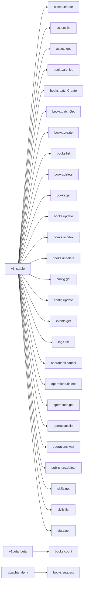

:::caution
The public address of the console, api, mcp, docs is not set yet. This page shows the local addresses. Set the address in packages/config/factual-urls.json.
:::

The API names its version in the path, as AIP-185 asks. A stable version changes only in ways that do not break clients. A beta version may still change. An alpha version may change or go away without notice.

## v1

Stability: stable. Path prefix: `/v1/`. Reference: [OpenAPI v1](/openapi/v1/).

Capabilities: assets.create, assets.list, assets.get, books.archive, books.batchCreate, books.batchGet, books.create, books.list, books.delete, books.get, books.update, books.reindex, books.undelete, config.get, config.update, events.get, logs.list, operations.cancel, operations.delete, operations.get, operations.list, operations.wait, publishers.delete, skills.get, skills.list, stats.get.

## v1beta

Stability: beta. Path prefix: `/v1beta/`. Reference: [OpenAPI v1beta](/openapi/v1beta/).

Capabilities: books.count.

## v1alpha

Stability: alpha. Path prefix: `/v1alpha/`. Reference: [OpenAPI v1alpha](/openapi/v1alpha/).

Capabilities: books.suggest.

