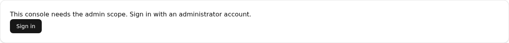
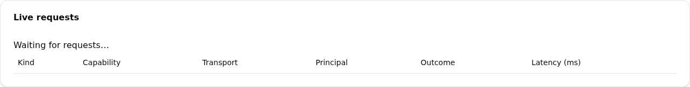
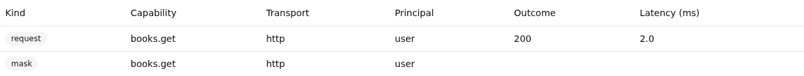
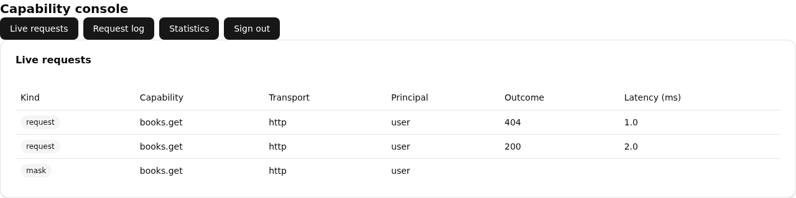
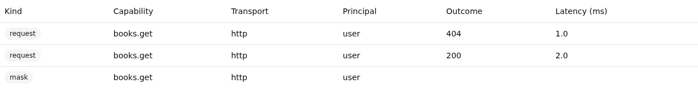

:::caution
The public address of the console, api, mcp, docs is not set yet. This page shows the local addresses. Set the address in packages/config/factual-urls.json.
:::

## Goal

Requests handled by the API appear in the live view without a refresh, with their transport, caller, outcome and latency. These are recorded examples. Changing measurements and progress counters use labelled placeholders. Stream read boundaries are combined; progress shows representative first and last samples. Repeated working-task polls are shown once per task. Complete recordings and checks remain in internal evidence.

Category: UI. This page has 6 step(s). 6 passed.

## Before you start

- The console address is `http://localhost:5173`.

## Steps

### CONSOLE: Open the console

Flag: **PASSED**

Where: The console address in the browser

URL: `http://localhost:5173/`

Action: Open the console page

Expected result: The page says that an administrator is needed

Checks:

- PASSED: Text expected visible: "This console needs the admin scope. Sign in with an administrator account."
- PASSED: The page raised no error



### CONSOLE: Sign in with the authorization code flow

Flag: **PASSED**

Where: The console start page

URL: `http://localhost:5173/`

Action: Click the Sign in button

Expected result: The console title and the Live requests menu appear

Checks:

- PASSED: Text expected visible: "Capability console"
- PASSED: Text expected visible: "Live requests"
- PASSED: The page raised no error


### CONSOLE: Nothing has happened yet

Flag: **PASSED**

Where: The Live requests view

URL: `http://localhost:5173/`

Action: Look at the table

Expected result: The view says that it is waiting for requests

Checks:

- PASSED: Text expected visible: "Waiting for requests…"
- PASSED: The page raised no error



### CONSOLE: The API handles a request

Flag: **PASSED**

Where: The API, outside the console

Action: Send GET /v1/publishers/acme/books/dune to the API

Expected result: The API answers with HTTP 200

Checks:

- PASSED: Text expected visible: "books.get"
- PASSED: The page raised no error

Command:

```bash
curl --request GET 'https://localhost:8443/v1/publishers/acme/books/dune' \
  --header 'authorization: Bearer <YOUR_ACCESS_TOKEN>' \
  --header 'content-type: application/json'
```



### CONSOLE: The API handles a failing request

Flag: **PASSED**

Where: The API, outside the console

Action: Send GET /v1/publishers/acme/books/none to the API

Expected result: The API answers with HTTP 404

Checks:

- PASSED: The page raised no error

Command:

```bash
curl --request GET 'https://localhost:8443/v1/publishers/acme/books/none' \
  --header 'authorization: Bearer <YOUR_ACCESS_TOKEN>' \
  --header 'content-type: application/json'
```



### CONSOLE: Both requests are listed

Flag: **PASSED**

Where: The Live requests view

URL: `http://localhost:5173/`

Action: Look at the table

Expected result: The table lists books.get with the statuses 200 and 404

Checks:

- PASSED: Text expected visible: "books.get"
- PASSED: Text expected visible: "200"
- PASSED: Text expected visible: "404"
- PASSED: The page raised no error



## If something goes wrong

If a step fails, read the [access errors](/troubleshooting/errors-access/), the [input errors](/troubleshooting/errors-input/), the [state errors](/troubleshooting/errors-state/) and the [server errors](/troubleshooting/errors-server/).
