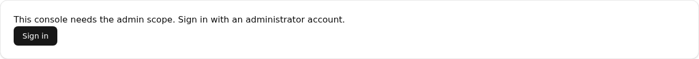

:::caution
The public address of the console, api, mcp, docs is not set yet. This page shows the local addresses. Set the address in packages/config/factual-urls.json.
:::

## Goal

The console asks for an administrator, sends the browser through the authorization code flow with PKCE, and keeps the token in memory only. These are recorded examples. Changing measurements and progress counters use labelled placeholders. Stream read boundaries are combined; progress shows representative first and last samples. Repeated working-task polls are shown once per task. Complete recordings and checks remain in internal evidence.

Category: UI. This page has 4 step(s). 4 passed.

## Before you start

- The console address is `http://localhost:5173`.

## Steps

### CONSOLE: Open the console

Flag: **PASSED**

Where: The console address in the browser

URL: `http://localhost:5173/`

Action: Open the console page

Expected result: The page says that an administrator is needed

Checks:

- PASSED: Text expected visible: "This console needs the admin scope. Sign in with an administrator account."
- PASSED: The page raised no error

### CONSOLE: Sign in with the authorization code flow

Flag: **PASSED**

Where: The console start page

URL: `http://localhost:5173/`

Action: Click the Sign in button

Expected result: The console title and the Live requests menu appear

Checks:

- PASSED: Text expected visible: "Capability console"
- PASSED: Text expected visible: "Live requests"
- PASSED: The page raised no error

### CONSOLE: The token is nowhere in browser storage

Flag: **PASSED**

Where: The signed-in console

URL: `http://localhost:5173/`

Action: Look at the browser storage

Expected result: No token is in local storage, session storage or cookies

Checks:

- PASSED: Token is not in browser storage
- PASSED: The page raised no error

### CONSOLE: Reloading signs the user out again

Flag: **PASSED**

Where: The signed-in console

URL: `http://localhost:5173/`

Action: Reload the page

Expected result: The page asks for an administrator again and the Request log menu is gone

Checks:

- PASSED: Text expected visible: "This console needs the admin scope. Sign in with an administrator account."
- PASSED: Text expected hidden: "Request log"
- PASSED: Token is not in browser storage
- PASSED: The page raised no error

## If something goes wrong

If a step fails, read the [access errors](/troubleshooting/errors-access/), the [input errors](/troubleshooting/errors-input/), the [state errors](/troubleshooting/errors-state/) and the [server errors](/troubleshooting/errors-server/).
