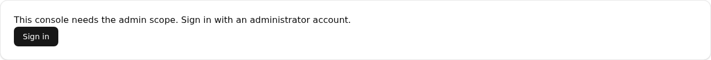

:::caution
The public address of the console, api, mcp, docs is not set yet. This page shows the local addresses. Set the address in packages/config/factual-urls.json.
:::

## Goal

A user without the admin scope signs in but is shown no data, and the console never asks the API for any. These are recorded examples. Changing measurements and progress counters use labelled placeholders. Stream read boundaries are combined; progress shows representative first and last samples. Repeated working-task polls are shown once per task. Complete recordings and checks remain in internal evidence.

Category: UI. This page has 2 step(s). 2 passed.

## Before you start

- The console address is `http://localhost:5173`.

## Steps

### CONSOLE: Open the console

Flag: **PASSED**

Where: The console address in the browser

URL: `http://localhost:5173/`

Action: Open the console page

Expected result: The page says that an administrator is needed

Checks:

- PASSED: Text expected visible: "This console needs the admin scope. Sign in with an administrator account."
- PASSED: The page raised no error

### CONSOLE: Sign in as a reader

Flag: **PASSED**

Where: The console start page

URL: `http://localhost:5173/`

Action: Click the Sign in button as a user without the admin scope

Expected result: The page still asks for an administrator and no data request is made

Checks:

- PASSED: Text expected visible: "This console needs the admin scope. Sign in with an administrator account."
- PASSED: Text expected hidden: "Request log"
- PASSED: Request forbidden and not made: /v1/stats
- PASSED: Request forbidden and not made: /v1/logs
- PASSED: Request forbidden and not made: /v1/events
- PASSED: The page raised no error

## If something goes wrong

If a step fails, read the [access errors](/troubleshooting/errors-access/), the [input errors](/troubleshooting/errors-input/), the [state errors](/troubleshooting/errors-state/) and the [server errors](/troubleshooting/errors-server/).
