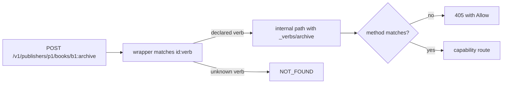

| Method kind | HTTP   | Path                                                     |
| ----------- | ------ | -------------------------------------------------------- |
| Get         | GET    | `/v1/publishers/{publisher}/books/{book}`                |
| List        | GET    | `/v1/publishers/{publisher}/books`                       |
| Create      | POST   | `/v1/publishers/{publisher}/books?bookId=...`            |
| Update      | PATCH  | `/v1/publishers/{publisher}/books/{book}?updateMask=...` |
| Delete      | DELETE | `/v1/publishers/{publisher}/books/{book}`                |
| Custom      | POST   | `/v1/publishers/{publisher}/books/{book}:archive`        |
| Batch get   | GET    | `/v1/publishers/{publisher}/books:batchGet`              |

Fields are lowerCamelCase on the wire (snake_case is accepted on input). Lists take `pageSize`, `pageToken`, `orderBy` and `filter`. Updates take `updateMask` and an optional `etag`. Soft deletes set `deleteTime` and `purgeTime` and can be undone with `:undelete`. Long-running work returns an `Operation` that is read at `/v1/operations/{id}`.

Hono treats `:` as a parameter marker, so custom methods are matched by the router wrapper and rewritten to an internal path before Hono sees them:

Errors use the AIP-193 body with an `ErrorInfo` detail whose `reason` comes from a fixed list. See [retry guidance](./retry-guidance.md) for which errors may be retried.
