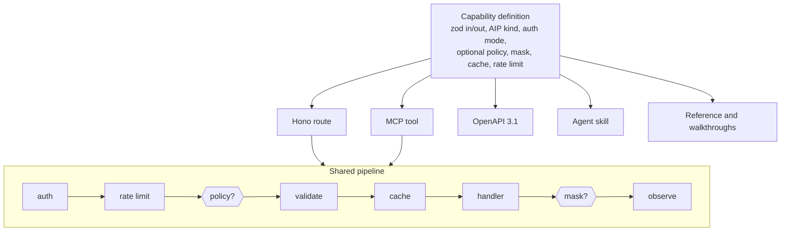

# Architecture

How one capability definition becomes every interface.

A capability is declared once with Zod schemas for input and output, an explicit auth mode, and optional `policy`, `mask`, `cache` and `rateLimit` blocks. Adapters translate the wire format and hold no business or security logic; everything else lives in one shared pipeline.

Policy and masking are separate steps that share only the principal type. A capability that declares neither skips both. A declared block with no implementation fails closed before the handler runs.

## Lazy and bounded

Capabilities register a loader, so a capability's module is imported on first use. Anything the process remembers (cache entries, rate-limit windows, idempotency records, operations) lives in a bounded, expiring store, so memory cannot grow without limit.

See [authentication](./auth-modes.md) for who is allowed in, and [policy and masking](./policy-and-masking.md) for what they may do and see.
