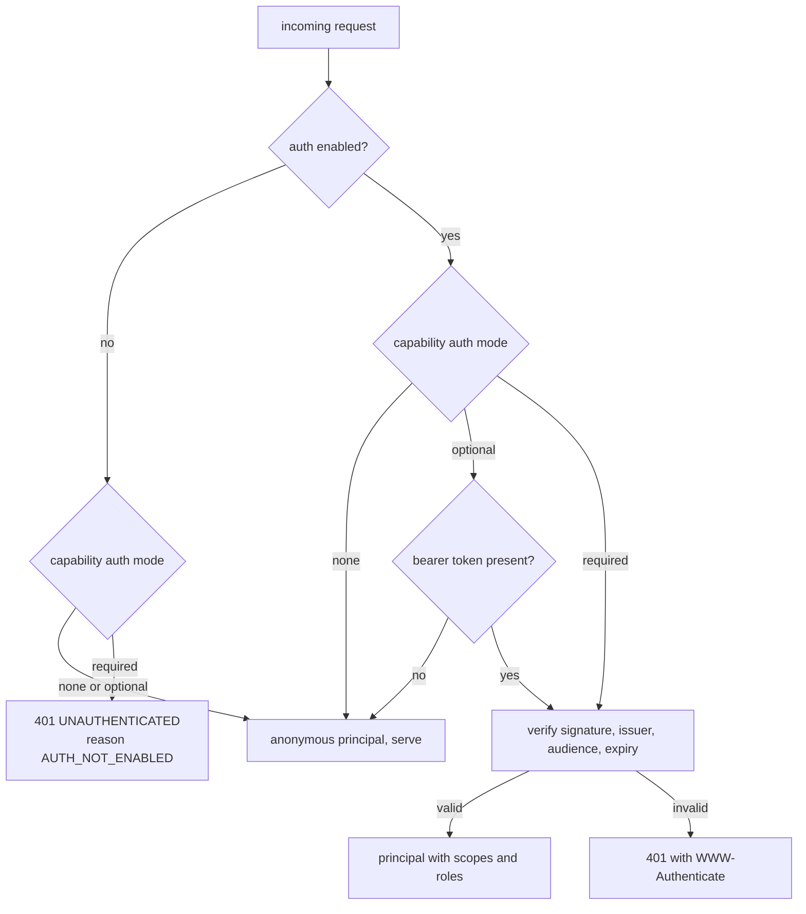
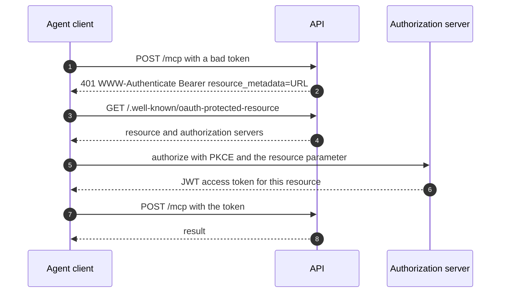

Authentication has three layers.

1. **Enablement.** The `AUTH_ENABLED` setting turns authentication on or off for the whole server. In production it must be set explicitly.
2. **Capability auth mode.** Every capability declares `none`, `optional` or `required`.
3. **Provider.** A provider verifies bearer tokens. `better-auth` is the reference implementation; `jwks` verifies tokens from any external OpenID Connect issuer.

A required capability is also absent from MCP tool lists and skill listings for callers who could not use it.

## How an agent gets a token

Tokens are short lived because a JWT cannot be revoked on the server. Dynamic client registration is off; clients identify themselves with Client ID Metadata Documents.
