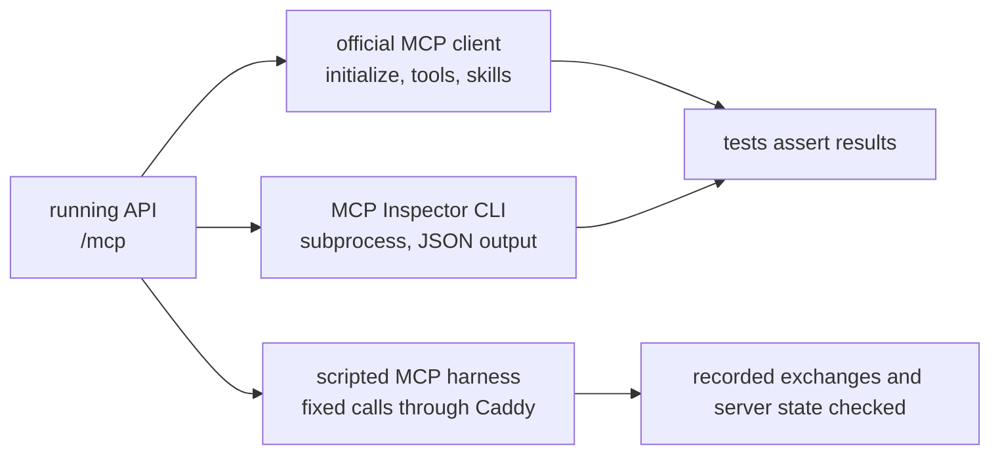

The MCP endpoint is checked with three real clients, not only with in-process tests.

## Official client and Inspector

`testing/integration/api/mcp-clients.test.ts` starts the API and drives it with `@modelcontextprotocol/client` and with the Inspector CLI (`mcp-inspector --cli <url> --method tools/list`). It asserts that the tool list depends on the caller (29 tools for an administrator, 14 for a reader, 4 anonymously, which includes the tools `skills.list` and `skills.get`). It asserts that `tools/call` returns the same structured result as the HTTP API. It asserts that a write made through the Inspector is visible through HTTP. It asserts that `skills/list` publishes one skill per resource collection. A parity test checks that every tool's inputs are the matching OpenAPI operation's path-derived `name` or `parent` plus its query and body fields.

## Test the harness without model usage

The automated MCP harness uses deterministic scripted calls through Caddy and injected stubs for orchestration and transcript handling. It never starts a model CLI, reads provider credentials or requests inference. No model usage or token cost is permitted. `bun run mcp:harness-check` runs this cost-free check; `mcp:llm-check` remains a compatibility alias. The end-to-end harness case records scripted client exchanges; the fast source lane runs its stubbed unit tests.

The scripted acceptance client checks four cases: a book lifecycle with an independent HTTP state check, reader write refusal, anonymous public configuration and skill lookup. Recordings carry `mode: "scripted"`; they are not model transcripts. The command requires only the product test stack. No Claude account or sign-in is required.

The scripted client calls the published MCP tool names and checks their generated input schemas. See the [generated SDK](./sdk.md) for the HTTP side.

## Tasks and operation progress

The official client fixture pins protocol revision 2026-07-28. For task-capable requests, declare `io.modelcontextprotocol/tasks` in the request's client capabilities. A long-running tool returns inline task fields and `resultType: "task"`. Poll `tasks/get` using the returned taskId; send `Mcp-Name` with that same taskId. The final task includes the Operation in its tool result. Cancel with `tasks/cancel`. Handles belong to the caller that created them, and polling does not extend their lifetime. A completed business failure is a tool result with isError true.

A client that omits the extension receives the ordinary Operation result. Call operations.wait with a progressToken to receive notifications/progress. A task-capable operations.wait returns a handle immediately. Task polling carries progress in the Operation metadata and does not mix in inline progress notifications.

`testing/integration/api/mcp-tasks.test.ts` checks these paths with the official Tasks client. `testing/e2e/stack/mcp-tasks.test.ts` runs its edge client against the packaged API through Caddy, with certificate verification, real JWT verification and capability policy checks. Its workload delay makes intermediate progress and cancellation observable. Reviewed implementation evidence is in `openspec/changes/archive/2026-11-08-stream-all-responses/evidence/5.1-task-implementation.md`; the final requirement audit records completed acceptance.

The original MCP real-client and Inspector cases, Tasks cases, MCP E2E cases and package-skill E2E cases now run in isolated edge consumers against the source API through Caddy. Each suite adds a configured direct-port refusal. The Inspector keeps its Node runtime in the existing checks image identified by the Containerfile hash. Its stdout and stderr are drained together and nonzero exits fail. The Tasks helper preserves fixture path prefixes. Child coverage and timings use separate per-entry directories; a measured five-suite run retained all sixty-five client cases and seventy-five timings. The later complete proxy migration and full audit passed; see the archived final requirement audit.

| Source               | URL                                                                                                     | Fetched UTC              | HTTP | SHA-256                                                          | Passage                                  | Falsification                                                                                                     |
| -------------------- | ------------------------------------------------------------------------------------------------------- | ------------------------ | ---- | ---------------------------------------------------------------- | ---------------------------------------- | ----------------------------------------------------------------------------------------------------------------- |
| MCP Tasks 2026-07-28 | https://raw.githubusercontent.com/modelcontextprotocol/ext-tasks/main/specification/2026-07-28/tasks.md | 2026-11-07T13:32:51.592Z | 200  | 5fc22b9b5ff248703927c69855f751a061c2d6170f4dc3923204452f859f91a5 | `type CreateTaskResult = Result & Task;` | The official client rejected nested fields; inline handles and tagged final results passed the integration suite. |

The operation lifecycle, MCP operation events, HTTP/MCP parity and administrator event suites run in isolated edge consumers through Caddy. All sixty original cases and their deadlines remain; four direct-backend refusals bring the client total to sixty-four. A measured run merged 235 source files and seventy-two timings, with all twenty-two operation budgets passing. Per-case APIs keep separate databases and real JWT verification; operation groups share their real issuer through explicit fixture IDs. Browser preflight and skill-directory cases use the proxy too. The later complete proxy migration and full audit passed; see the archived final requirement audit.

Both MCP adapter integration suites now run their original forty-two cases through Caddy from isolated edge consumers, plus two direct-port refusals. Real source factories retain custom tools, invalid-token challenges, discovery, skills digests, origin policy, rate limits and lazy loading. The no-expiry negative provider remains a deterministic stub. Protected-resource metadata keeps both root and path-specific resource assertions. A measured run with SDK regression coverage passed sixty-six client cases and seventy-two timings, merging 222 source files with all sixteen API operation budgets passing.

Fresh scripted harness reports are written to `.stack/e2e/mcp-harness.json`; the E2E case writes `.stack/e2e/mcp-harness-e2e.json`. Reviewed OpenSpec evidence remains a frozen delivery record. Running either command after archival does not recreate the active change folder.
