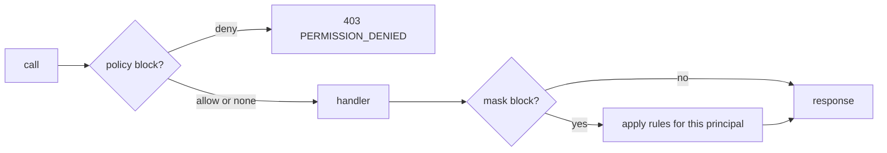

Policy and masking are two independent, opt-in steps.

- **Policy** runs before the handler and answers one question: may this principal invoke this capability? It checks allowed principal kinds, required scopes and any-of roles. A denial is `PERMISSION_DENIED` and happens before validation, so a denied caller learns nothing about the input or whether a resource exists.
- **Masking** runs after the handler and decides which fields the principal sees. Rules are `remove`, `replace` or `partial`, with an optional scope that exempts the caller.

Cached values are stored before masking, so every caller is masked on its own. The same list of masked paths feeds the logger's redaction, so a field hidden from a response is also hidden from logs.

The [masking walkthrough](../apps/docs/src/content/docs/api-handling/masking.mdx) shows the same record as an anonymous caller and as a reader see it.
