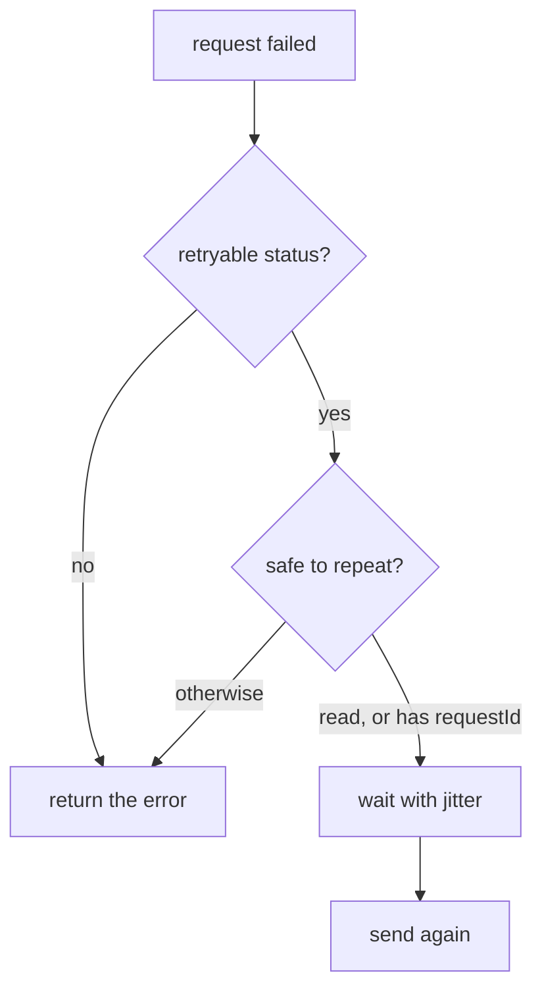

Clients may retry only failures that can succeed later, and should add jitter to any back-off (AIP-194).

| Status                                                                      | Retry?                     | Notes                                                                                     |
| --------------------------------------------------------------------------- | -------------------------- | ----------------------------------------------------------------------------------------- |
| `UNAVAILABLE` (503)                                                         | Yes                        | Back off exponentially.                                                                   |
| `RESOURCE_EXHAUSTED` (429)                                                  | Yes                        | Wait for the `Retry-After` header, or `retryAfterSeconds` in the error metadata over MCP. |
| `ABORTED` (409)                                                             | Yes, after re-reading      | An `etag` mismatch: fetch the resource again and reapply the change.                      |
| `DEADLINE_EXCEEDED` (504)                                                   | Only if idempotent         | Use a `requestId` so a repeat does not run twice.                                         |
| `INVALID_ARGUMENT`, `FAILED_PRECONDITION`, `NOT_FOUND`, `PERMISSION_DENIED` | No                         | Fix the request or the state first.                                                       |
| `UNAUTHENTICATED` (401)                                                     | After refreshing the token | Follow the `WWW-Authenticate` challenge.                                                  |

A create or custom method that carries a UUID `requestId` replays its first response for a repeated request, so a retry cannot create a second resource.
