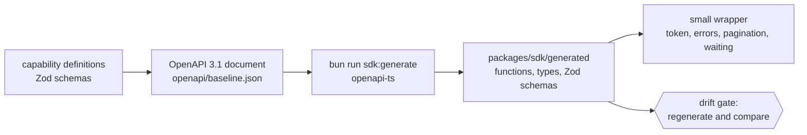

`packages/sdk` is generated from `openapi/baseline.json` by `@hey-api/openapi-ts`. Nothing in `packages/sdk/generated` is edited by hand: every operation function, every request and response type and every Zod schema comes from the OpenAPI document, which itself comes from the capability definitions.



## Using it

```ts
import { booksCreate, booksGet, createSdkClient, unwrap } from "@platform/sdk";

const client = await createSdkClient({ origin: "https://api.example.com", token: () => currentToken() });

await unwrap(booksCreate({ client, path: { publisher: "acme" }, query: { bookId: "dune" }, body: { title: "Dune" } }));
const book = await unwrap(booksGet({ client, path: { publisher: "acme", book: "dune" } }));
```

Operation names come from the capability ids (`books.get` becomes `booksGet`). Path, query and body types come from the document, so a wrong field name is a compile error.

## The wrapper

The hand-written part is small and follows the repository rules.

- `await createSdkClient({ origin, token })` is asynchronous and sets the base URL and sends the bearer token (a string or a function read on every call).
- `unwrap(call)` returns the data or throws an `ApiClientError` carrying the AIP-193 status, the `ErrorInfo` reason and the HTTP status.
- `paginate(fetchPage)` is a lazy async generator that follows page tokens.
- `waitForOperation(read)` polls a long-running operation with a bounded wait.
- `followOperation(client, name)` yields operation events until completion and raises typed errors for cancellation, failed operations or an incomplete event stream.
- `uploadAsset` sends a ReadableStream with its media type and checksum. `downloadAsset` reads owner-authorized metadata and streams the returned signed URL.

## Keeping it honest

When the API changes, `bun run openapi:update` rewrites the baseline and `bun run sdk:generate` rewrites the SDK. The `sdk` job in the pre-commit hook and the `sdk` step of `bun run verify` regenerate into a temporary directory and compare with the committed code, and they type-check the generated code. A hand edit, a missing file or a stale SDK fails both. The tests call the generated functions against a real running server for every capability, every error status and long-running polling.

See the [MCP clients](./mcp-clients.md) guide for the other interface.

## Documentation verification

SDK documentation is generated from the installed package through Caddy. Each scenario gets a fresh scoped API backend, and its consumer runs in the edge network with the proxy certificate trusted. Scenarios run in sequence; the recorder writes pages after all scenarios pass. Unit tests inject packing, recording and stack lifecycle. The real output and failure assertions run in the SDK end-to-end suite. No model inference is used.

## Stream acceptance

The SDK E2E suite retains installed-package resolution, declaration compilation, wrong-type refusal and failed-publication assertions. It also installs the packed SDK into three isolated consumers and injects the built curl transport through client fetch configuration. These consumers negotiate HTTP/1.1, HTTP/2 and HTTP/3 through Caddy with certificate verification enabled. They check typed JSON, complete-page iteration, operation events, typed errors, incremental NDJSON input and binary upload/download checksums. This transport injection tests SDK parsing over negotiated protocols; it does not claim native fetch supports HTTP/3.

The successful matrix records request headers, negotiated protocol and response chunks in `.stack/e2e/sdk-protocols.json`. Normal documentation production renders `apps/docs/src/content/docs/sdk-usage/streamed-responses.mdx`. Publication requires all three clients to pass. Opaque page tokens and signed URLs are displayed as named placeholders; current values come from preceding responses. The raw recording retains observed values. Whole-site determinism and remaining API integration migration are still open in the product change.

SDK integration now runs all twenty-one original cases in an isolated edge consumer through Caddy, plus a direct-backend refusal assertion. Per-case authentication and memory databases remain in the real source API backend. The backend runs as a Bun test with the existing metrics preload and exits gracefully before cleanup. Coverage orchestration passes `TEST_CHILD_REPORT_DIR` and merges nested LCOV and JUnit reports, retaining API and SDK source coverage and individual child timings. Ordinary fast integration runs do not request coverage. No model client or inference is involved.
