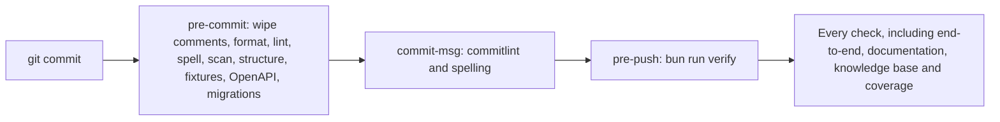

# Development standards

The rules every change must follow and the check that enforces each one.

Every rule is enforced by a blocking commit or push check and by `bun run verify`. Use focused checks while building a substantive batch; the full delivery gate runs once at push.

- Biome formats and lints TypeScript, JavaScript, JSON and CSS; dprint formats Markdown, TOML, YAML and container build files. Each file type has exactly one owner.
- No inline string literals outside the constants and messages packages. Closed sets of strings are enums; text for people is a message id.
- No interfaces, type aliases or inline object types outside the types package. Data shapes are Zod schemas; contracts with methods are interfaces in the types package.
- At most two levels of nesting. Tests are flat: no loops, conditionals or try blocks.
- No comments of any kind. Tool exceptions go in configuration files, and a wipe step removes comments from staged files.
- Everything is asynchronous. Nothing holds an unbounded collection for the life of the process, and heavy modules are loaded on first use (this one is a warning, with an ignore list).
- Spelling is checked in code, docs and commit messages. Secrets are scanned. Mermaid diagrams must parse. Every package has a README.
- The OpenAPI document may not change incompatibly within a major version, and database migrations must match the schema.

