## Context

The repository has no code and no specs. The goal is a Bun monorepo where one capability definition drives HTTP, MCP, OpenAPI, agent skills and docs. Research was done on 2026-10-31 from primary sources; every decision below carries its links, and the proposal's Research Basis holds the full source tables.

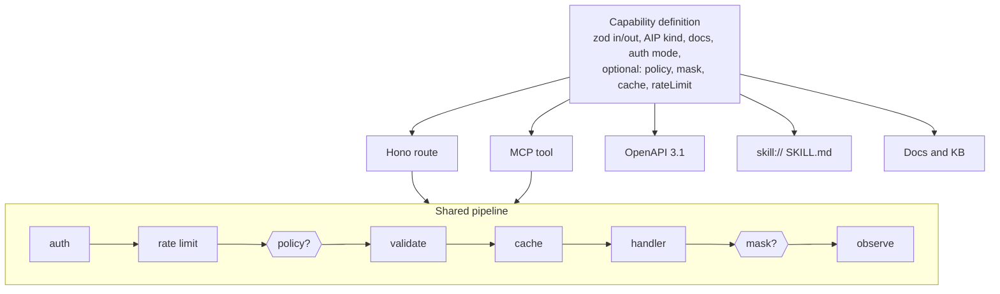

## Goals / Non-Goals

**Goals:**
- One definition per endpoint; adapters hold no business or security logic.
- Policy and masking are separate middlewares, each opt-in per capability.
- Authentication is switchable; authless capabilities are first-class. When enabled, Hono uses Better Auth with JWT access tokens.
- Conform to MCP 2026-07-28, the Skills extension and the AIPs in the proposal.
- Zero raw strings in package code: every string is an enum, const union, catalog message or typed config value.
- Docs, OpenAPI, MCP schemas and skills are generated, never hand-written.
- Biome, dprint and cspell are mandatory gates in git hooks; the same checks run through one local `verify` script and through a committed (currently disabled) GitHub workflow.

**Non-Goals:**
- Console write or control actions (read-only for now).
- Production persistence (SQLite + Drizzle is a POC skeleton).
- A mandated production authorization server: production auth depends on the implementation a deployer plugs in (D3).
- Custom MCP protocol code: sessions, handshakes and transports come from the SDK.
- AIP-162 revisions (Draft) and the date-based `X-Goog-Api-Version` header.
- Choosing a license; that is left to the repository owner.

## Decisions

### D1. MCP core is the official TypeScript SDK v2, used directly
[`@modelcontextprotocol/server`](https://github.com/modelcontextprotocol/typescript-sdk) v2 runs on Node, Bun and Deno, serves both protocol eras from one [`createMcpHandler`](https://ts.sdk.modelcontextprotocol.io/v2/serving/hono.html) Fetch handler (`legacy: 'stateless'` by default), mounts in Hono through `@modelcontextprotocol/hono` (`createMcpHonoApp`, which adds JSON body parsing and DNS-rebinding protection), registers tools with Zod 4 through Standard Schema, and ships a Skills extension.

| Option | Result |
|---|---|
| [FastMCP (Python)](https://gofastmcp.com/servers/skills) | Serves 2026-07-28 and has skills (4.2.0, experimental), plus strong per-component auth, visibility and versioning. Rejected only because the repo is Bun/TypeScript. Used as a design reference for policy-filtered listing |
| [PrefectHQ/fastmcp-ts](https://github.com/PrefectHQ/fastmcp-ts) | Speaks both eras; adds `jwtVerifier` and middleware; no documented skills or Hono mounting; would duplicate our pipeline middleware |
| [punkpeye/fastmcp](https://github.com/punkpeye/fastmcp) | Legacy revisions only |
| Hand-rolled protocol | Rejected |

The handler factory runs once per request and receives `ctx.authInfo`, so the registry is filtered by policy before `registerTool` and `tools/list` automatically varies by authorization, which [the spec allows](https://modelcontextprotocol.io/specification/2026-07-28/server/tools). Compatibility choice: keep `legacy: 'stateless'` so current agent harnesses on 2025-11-25 still work; both eras call the same pipeline. Better Auth's MCP guide recommends `legacy: 'reject'`; that applies to a deployment that only serves modern clients and is a config switch here.

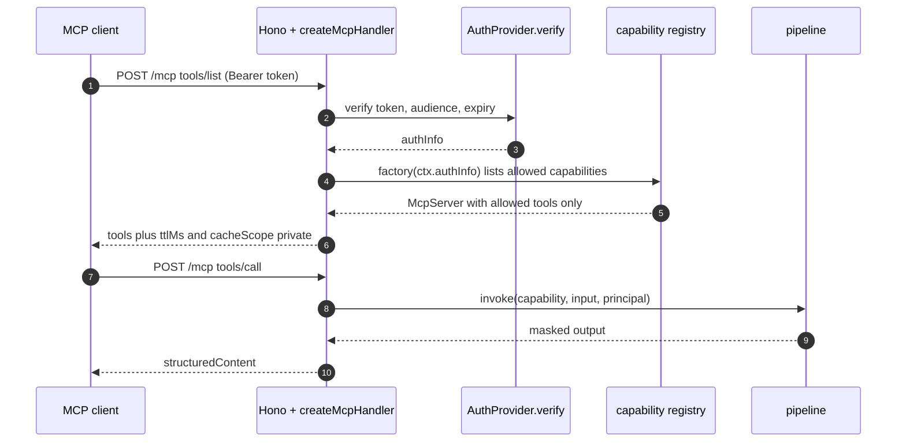

### D2. Spec-mandated MCP behavior we still own
Source: [caching](https://modelcontextprotocol.io/specification/2026-07-28/server/utilities/caching.md), [resources](https://modelcontextprotocol.io/specification/2026-07-28/server/resources), [Streamable HTTP](https://modelcontextprotocol.io/specification/2026-07-28/basic/transports/streamable-http).
- Results of `server/discover`, `tools/list`, `resources/list`, `resources/read` carry `ttlMs` and `cacheScope`. Per-caller lists use `private`; the SDK `cacheHint` option covers skills; for tools the adapter derives it from the capability `cache` block (default `ttlMs: 0`, `private`). `cacheScope` is never access control.
- Resource-not-found is `-32602`, never an empty `contents`. Tokens never in the query string. Origin validation stays on.
- Tool annotations come from the AIP method kind: `readOnlyHint` for Get, List and `GET` custom methods; `destructiveHint` for Delete and expunge; `idempotentHint` for Update, Delete and calls carrying `requestId`.

### D3. Authentication: switchable, pluggable, Better Auth with JWT as the shipped implementation
Sources: Better Auth [Hono integration](https://www.better-auth.com/docs/integrations/hono), [JWT plugin](https://www.better-auth.com/docs/plugins/jwt), [MCP plugin](https://www.better-auth.com/docs/plugins/mcp), [OAuth provider](https://www.better-auth.com/docs/plugins/oauth-provider), [Bearer plugin](https://www.better-auth.com/docs/plugins/bearer), [Admin plugin](https://www.better-auth.com/docs/plugins/admin), [security](https://www.better-auth.com/docs/reference/security), [options](https://www.better-auth.com/docs/reference/options), [repo](https://github.com/better-auth/better-auth) (MIT, v1.7.14 on 2026-10-26); MCP side: [authorization](https://modelcontextprotocol.io/specification/2026-07-28/basic/authorization), [AS discovery](https://modelcontextprotocol.io/specification/2026-07-28/basic/authorization/authorization-server-discovery.md), [RFC 9728](https://www.rfc-editor.org/rfc/rfc9728), [SDK authorization guide](https://ts.sdk.modelcontextprotocol.io/v2/serving/authorization.html).

Three layers:
1. **Enablement.** Config `auth.enabled` (Better Auth documents no global off switch, only `disabledPaths` and optional plugins, so the switch is ours: when off, the auth routes are not mounted and the verifier is not called). Config is validated by the `config` package; in a production environment the value must be set explicitly, otherwise startup fails.
2. **Capability auth mode.** Every capability declares `auth: 'none' | 'optional' | 'required'`. `none` capabilities never look at credentials. `optional` capabilities run anonymously when no token is presented. `required` capabilities need a valid token. With `auth.enabled = false`, `none` and `optional` capabilities are served, and `required` ones fail closed (HTTP 401 `UNAUTHENTICATED` with reason `AUTH_NOT_ENABLED`, absent from MCP `tools/list` and `skills/list`).
3. **Provider.** Authentication goes through an `AuthProvider` interface (`verify(request) -> AuthInfo | undefined`, resource metadata, optional route mounting). Two providers ship: `better-auth` (reference implementation) and `jwks` (verify JWTs from any external OIDC issuer using issuer, JWKS URL and audience from config). Production authorization therefore depends on the implementation a deployer chooses; the platform only requires a verifiable JWT.

Better Auth wiring: `betterAuth({ database, basePath, trustedOrigins, plugins: [jwt(...), mcp({ loginPage, consentPage, resource }), admin()], disabledPaths: ['/token'] })`. The JWT guide requires `/token` disabled and `disableSettingJwtHeader` set when the MCP or OIDC plugins issue tokens, and the MCP guide requires the JWT plugin. `mcp()` and `oauthProvider()` are not registered together. The Hono handler is mounted before any catch-all route (`app.all('/api/auth/*', c => auth.handler(c.req.raw))`), with CORS registered before it and `credentials: true` with an explicit origin. JWTs default to EdDSA (Ed25519), 15-minute expiry, JWKS at `/api/auth/jwks`, key rotation configurable; the access token `aud` is the configured `resource` (RFC 8707). Verification uses jose `createRemoteJWKSet` and `jwtVerify` with issuer and audience (documented pattern), cached and refetched on an unknown `kid`. The Hono middleware in the `auth` package extracts the bearer token, calls the provider, and sets the principal; the same result is passed to the MCP handler as `authInfo`. JWT access tokens cannot be revoked server-side, so lifetimes stay short.

Resource identifier: one resource server serves both HTTP and MCP, so the default `auth.resource` is the API origin. Protected Resource Metadata is then served at `/.well-known/oauth-protected-resource` (RFC 9728 section 3.1), with `resource` equal to that identifier and at least one `authorization_servers` entry; 401 responses carry `WWW-Authenticate: Bearer resource_metadata=...`. The SDK's `requireBearerAuth` and `oauthMetadataResponse` supply the challenge mechanics. Configurable, with a conformance test using the SDK client, because the MCP docs only exemplify host-level and path-level resources.

Security settings carried over from the docs: `BETTER_AUTH_SECRET` of at least 32 characters (production errors if unset), secret rotation through `secrets`, `trustedOrigins` without localhost in production, secure cookies on HTTPS, Better Auth's own `rateLimit` enabled in production. Dynamic client registration is deprecated by MCP and stays off; Client ID Metadata Documents are the intended client identity, and the CIMD metadata fetch uses the transport shipped in `@better-auth/cimd/node`, which was verified to work under Bun: it refuses loopback, private and cloud-metadata addresses and plain HTTP, and returns redirects (301) instead of following them.

Persistence: Better Auth uses the Drizzle adapter over `bun:sqlite` (documented), with its tables generated by `auth generate --adapter drizzle` and applied through the same drizzle-kit migrations as the rest of the schema (the `migrate` command only applies to the Kysely adapter). The adapter import path differs between two docs pages (`@better-auth/drizzle-adapter` versus `better-auth/adapters/drizzle`), so the installed package decides. Bun is a documented path: the [installation page](https://better-auth.com/docs/installation) gives `bun add better-auth`, `bun x auth@latest generate` and `bun x auth@latest migrate`, the [Hono example](https://hono.dev/examples/better-auth) gives `bun add better-auth` and `bunx @better-auth/cli generate`, and the SQLite adapter documents `bun:sqlite`. What the pages do not contain is an explicit runtime-support statement or a `Bun.serve` example (the Hono tab uses `@hono/node-server`), so Bun is treated as supported and covered by an ordinary integration test rather than treated as a risk.

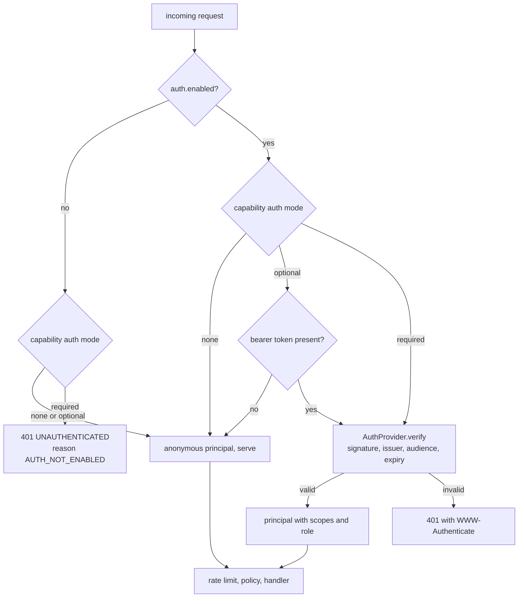

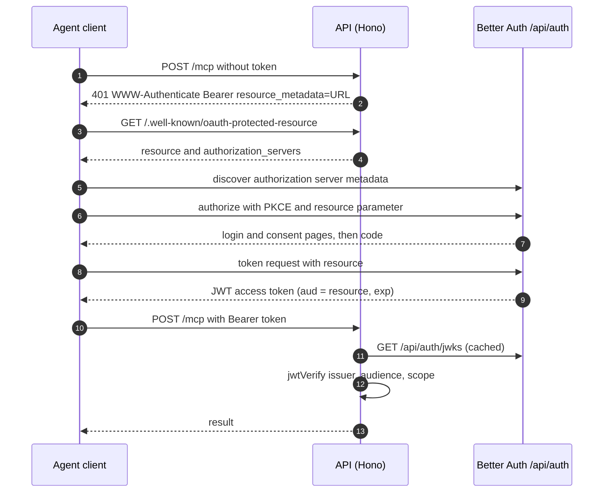

### D4. Skills come from the SDK, fed by the registry
Sources: [SEP-2640](https://github.com/modelcontextprotocol/modelcontextprotocol/blob/main/seps/2640-skills-extension.md), [SDK skills guide](https://ts.sdk.modelcontextprotocol.io/v2/servers/skills.html).
Use `SkillsExtension` with a custom `SkillSource` (extension id `io.modelcontextprotocol/skills`). `list`, `get` and `read` each receive `ctx`, so listings are filtered by the same policy as tools. Entries are built with `skillEntry()` from generated files, which computes digests, sizes and frontmatter checks. Skill content is generated per capability group from the registry with no scripts, hooks or `allowed-tools`. We never register our own resources under `skill://`. `attach` is marked experimental, so the integration sits behind `skill-protocol` and is pinned by version. The SEP defines no `skill://index.json`; `skills/list` replaces it.

### D5. HTTP layer: Hono with `@hono/zod-openapi`
Sources: [package.json](https://github.com/honojs/middleware/blob/main/packages/zod-openapi/package.json), [README](https://github.com/honojs/middleware/tree/main/packages/zod-openapi), [zod-to-openapi](https://github.com/asteasolutions/zod-to-openapi).
Zod 4 is supported (peers `zod ^4.0.0`, `hono >=4.10.0`; depends on `@asteasolutions/zod-to-openapi ^9.1.0`). OpenAPI 3.1 comes from `doc31()`; security schemes via `app.openAPIRegistry.registerComponent('securitySchemes', ...)` (an HTTP bearer scheme with `bearerFormat: JWT`; authless capabilities omit the `security` entry). One `createRoute` per capability is generated from the registry. The npm page was unreadable (403), so the installed version is pinned and a test asserts `openapi: 3.1.0`.

### D6. Capability definition is the single source of truth
`defineCapability()` takes Zod 4 schemas. MCP `inputSchema`/`outputSchema` and OpenAPI both derive from them ([`z.toJSONSchema`](https://zod.dev/json-schema) defaults to draft 2020-12, `io: 'input' | 'output'`). Fields carry [AIP-203](https://google.aip.dev/203) behavior (`REQUIRED`, `OUTPUT_ONLY`, `IMMUTABLE`, `INPUT_ONLY`) as Zod metadata, which drives validation and OpenAPI `readOnly`/`writeOnly`. Optional blocks: `policy`, `mask`, `cache`, `rateLimit`. The `auth` mode is mandatory and explicit (`none`, `optional` or `required`), so an authless capability is a visible choice.

### D7. Policy and masking are separate middlewares
Policy runs before the handler and answers "may principal P invoke capability C?" with allow or deny and a typed reason; permission is checked before existence ([AIP-193](https://google.aip.dev/193)). Masking runs after the handler and decides which fields P sees. They share the `Principal` type (anonymous, user or agent, scopes, roles) and no logic. Policy also drives tool and skill visibility. Masking applies to HTTP bodies, MCP `structuredContent`/`content`, logged payloads and KB transcripts. Design reference for per-component auth and visibility: [FastMCP authorization](https://gofastmcp.com/servers/authorization), [visibility](https://gofastmcp.com/servers/visibility.md).

### D8. AIP mapping decisions
Rules and sources are tabulated in the proposal. Decisions:
- Wire format: lowerCamelCase JSON per [ProtoJSON](https://protobuf.dev/programming-guides/json/) and [AIP-127](https://google.aip.dev/127); snake_case also accepted on input by a normalizer. Timestamps are RFC 3339 `*Time` strings, durations strings like `1.5s`, int64 as strings ([AIP-142](https://google.aip.dev/142)).
- Standard methods ([AIP-131](https://google.aip.dev/131), [132](https://google.aip.dev/132), [133](https://google.aip.dev/133), [134](https://google.aip.dev/134), [135](https://google.aip.dev/135)): Get `GET`; List `GET` with `pageSize`, `pageToken`, `orderBy`, `filter`, `view`, `showDeleted`; Create `POST` with `{resource}Id` query parameter; Update `PATCH` with `updateMask` (comma-separated camelCase paths, per ProtoJSON FieldMask) and optional `etag`, `allowMissing`; Delete `DELETE` returning `200 {}`.
- Errors ([AIP-193](https://google.aip.dev/193), [code.proto](https://github.com/googleapis/googleapis/blob/master/google/rpc/code.proto)): body `{"error":{code,message,status,details}}`, `code` is the HTTP status, always an `ErrorInfo` with `domain` from config and `reason` from the constants package. INVALID_ARGUMENT, FAILED_PRECONDITION, OUT_OF_RANGE map to 400; UNAUTHENTICATED 401; PERMISSION_DENIED 403; NOT_FOUND 404; ALREADY_EXISTS, ABORTED 409; RESOURCE_EXHAUSTED 429; CANCELLED 499; INTERNAL, UNKNOWN, DATA_LOSS 500; UNIMPLEMENTED 501; UNAVAILABLE 503; DEADLINE_EXCEEDED 504. Dynamic message parts go into `ErrorInfo.metadata`.
- Custom `:verb` methods ([AIP-136](https://google.aip.dev/136)): Hono treats `:` as the start of a parameter and has no escape ([#4562](https://github.com/honojs/hono/issues/4562) open; maintainer says it needs a router rewrite; the regex workaround in [#1301](https://github.com/honojs/hono/issues/1301) was never confirmed). We do not depend on Hono syntax: a thin `fetch` wrapper rewrites the public path to an internal one before routing.
- Filters ([AIP-160](https://google.aip.dev/160), [EBNF](https://google.aip.dev/assets/misc/ebnf-filtering.txt)): recursive-descent parser to a typed AST over a per-capability allowlist, following the published grammar: `OR` binds tighter than `AND`, whitespace-separated terms are an implicit `AND`, `NOT`/`-` apply to one term, keywords are case-sensitive. Values are type-checked per field kind; unknown fields, bad values and ordering comparators on booleans or enums are `INVALID_ARGUMENT`; global text search is not supported (a documented relaxation); a value that is unset never satisfies a restriction. Never interpolated into SQL.
- LRO ([AIP-151](https://google.aip.dev/151)): `Operation` with `name`, `done`, `metadata`, `response`, `error` at `GET /v1/operations/{id}`; start failures are plain errors.
- Idempotency and concurrency ([AIP-155](https://google.aip.dev/155), [154](https://google.aip.dev/154), [163](https://google.aip.dev/163)): optional `requestId` UUID with stored replay; `etag` mismatch is `ABORTED`; `validateOnly` runs every check without executing.
- Not adopted: [AIP-162](https://google.aip.dev/162) (Draft) and the [AIP-185](https://google.aip.dev/185) date header; major version in the path only. AIP-137 does not exist.

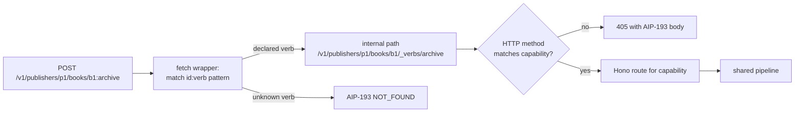

### D9. Shared pipeline, thin adapters
A pure function chain over a transport-neutral `CapabilityContext` (principal, request id, input, transport kind). Adapters translate wire format and map errors (AIP-193 JSON for HTTP, JSON-RPC errors for MCP). Cache keys include the principal's policy scope and values are stored pre-mask, so masking is always re-evaluated.

### D10. "No raw strings": Biome is the mandatory gate
Every custom string value is an enum or const union in the dedicated packages `constants`, `types`, `messages`, `config`. Biome v2 (pinned to 2.6.4, the current stable per the [changelog](https://biomejs.dev/internals/changelog/)) enforces it; this is not optional.
- A [GritQL plugin](https://biomejs.dev/linter/plugins/) in `tooling/biome/no-inline-strings.grit` registered under `plugins` with `includes` (negated globs exclude only the constants and messages packages, `testkit`, test files and generated files; the config package, tooling scripts and apps are checked). Base pattern, taken from the verified [grammar](https://github.com/biomejs/biome/blob/main/xtask/codegen/js.ungram) and the [recipes](https://biomejs.dev/recipes/gritql-plugins/) header form: `engine biome(1.0)`, `language js(typescript, jsx)`, `JsStringLiteralExpression() as $s where { register_diagnostic(span = $s, message = ..., severity = "error") }`.
- The grammar already excludes the legitimate string positions because they are different nodes: import and export sources (`JsModuleSource`), object and class member keys (`JsLiteralMemberName`), directives (`JsDirective`), enum member names (`TsLiteralEnumMemberName`) and template literals (`JsTemplateExpression`). Still matched and needing a decision: `require()` and dynamic `import()` arguments, computed keys, enum initializers and `as const` expressions. The Biome docs do not document a parent-scoped condition, but `not $s <: within JsImportCallExpression()` was verified to work in Biome 2.6.4 (used to allow dynamic `import()` specifiers), and `JsTemplateChunkElement()` flags static template text. Remaining cases are resolved by the fixture suite (`tooling/scripts/plugin-fixtures.test.ts`), path `includes`, and reviewed suppressions: Biome requires the form `// biome-ignore lint/plugin: reason` and reports `suppressions/parse` otherwise. Biome 2.6.4 also renamed `linter.rules.recommended` to `preset`.
- Built-in rules complement it: [`noRestrictedImports`](https://biomejs.dev/linter/rules/no-restricted-imports/javascript), [`noRestrictedGlobals`](https://biomejs.dev/linter/rules/no-restricted-globals/javascript); Biome has no `noRestrictedSyntax`.
- Acceptance: `biome lint --only=plugin` over a fixture suite (must flag inline strings, must pass constants, imports, keys, enums), run in hooks and `verify`. `biome search` is available for developing patterns without writing a plugin file.

### D11. Formatting, linting, spelling, secrets and hooks (all mandatory)
Biome 2.6.4 formats and lints JS, TS, JSX, TSX, JSON, JSONC, CSS, SCSS and GraphQL; its [language-support table](https://biomejs.dev/internals/language-support/) also marks YAML and Markdown formatting as supported, which overlaps dprint, and HTML, Vue, Svelte and Astro as experimental. To keep exactly one owner per file type:

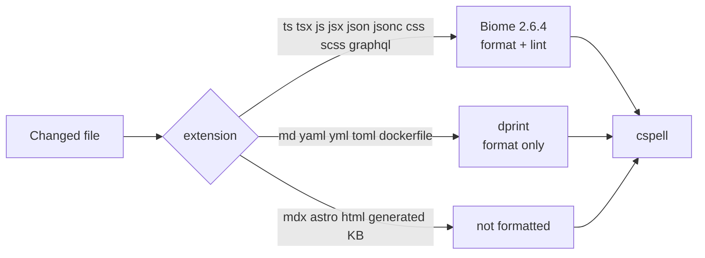

- **Biome** (mandatory): `formatter.includes` and `files.includes` negate md, yaml, yml, toml and the experimental web formats (feature-level includes can only narrow `files.includes`, per the [configuration reference](https://biomejs.dev/reference/configuration/)); linting stays on for everything it supports. Hook command from the [Biome recipe](https://biomejs.dev/recipes/git-hooks/): `biome check --write --no-errors-on-unmatched --files-ignore-unknown=true {staged_files}` with `stage_fixed: true` ([lefthook `stage_fixed`](https://lefthook.dev/configuration/stage_fixed/), pre-commit only). CI-style run: `biome ci` (`--changed --since=<ref>` needs `vcs.defaultBranch`).
- **dprint** (mandatory; [overview](https://dprint.dev/overview/), [CLI](https://dprint.dev/cli/), [config](https://dprint.dev/config/), [plugins](https://dprint.dev/plugins/)): owns Markdown (`dprint add markdown`), TOML, Dockerfile (official plugins) and YAML (community `pretty_yaml`). TypeScript, JavaScript and JSON plugins are not installed, so dprint never touches Biome's files. The dprint docs only describe plugin precedence ("define the one you want first"), not Biome coexistence, so non-overlap by plugin list and Biome includes is our rule. The Markdown plugin formats code blocks only with plugins that are present, so embedded TS blocks stay unchanged; Mermaid blocks are untouched. MDX has no dprint plugin, so MDX and the generated KB are not formatted. Hooks: pre-commit `dprint fmt --staged` (needs dprint 0.47+); pre-push and verify `dprint check` (exit code 20 means unformatted). [`npm install dprint`](https://dprint.dev/install/) is documented; Bun is not mentioned, so a hook test runs it with `bunx`.
- **cspell** (mandatory; [README](https://github.com/streetsidesoftware/cspell/tree/main/packages/cspell), [schema](https://raw.githubusercontent.com/streetsidesoftware/cspell/refs/heads/main/cspell.schema.json), [getting started](https://cspell.org/docs/getting-started)): major 10, Node 22+ per the README (the installation page still says 18+, so the README is trusted). `cspell.json` with `version: "0.2"`, `language: "en"`, dictionaries `softwareTerms`, `typescript`, `node`, `npm` and a committed `project-words.txt` (`dictionaryDefinitions` with `addWords: true`), `ignorePaths`, `useGitignore: true`, `failFast`. Pre-commit: `cspell --no-progress --no-must-find-files {staged_files}` (the README shows the same flags with `--file-list stdin`); verify: `cspell --no-progress --cache "**"`. Inline `cspell:ignore` allowed and checked with `--validate-directives`. Scope: source, docs, config and commit messages (commit-msg check proven by a fixture test, since file-path handling for extension-less files is undocumented).
- **Secret scanning** ([gitleaks](https://github.com/gitleaks/gitleaks)): README says feature complete, security patches only, successor Betterleaks; `protect` and `detect` deprecated; `stdin`, `git`, `dir` commands documented. Behind one wrapper script: pre-commit scans `git diff --cached` through `gitleaks stdin`; verify runs `gitleaks git`. Plus secretlint. A fixture test proves a fake credential is rejected, so the scanner is swappable. The binary is used directly (not the GitHub action, which needs a license key for organization-owned repos but not personal accounts, [per its README](https://github.com/gitleaks/gitleaks-action)).
- **Hooks**: lefthook runs Biome, dprint, cspell, secret scan and the plugin fixture check in parallel on pre-commit; pre-push runs `{push_files}` checks and `dprint check`; commit-msg runs commitlint and cspell. `prepare` installs hooks automatically. Also knip, dependency audit and `oasdiff breaking --fail-on ERR` ([OpenAPI 3.1 since v1.15.0](https://github.com/oasdiff/oasdiff/blob/main/docs/OPENAPI-31.md)).

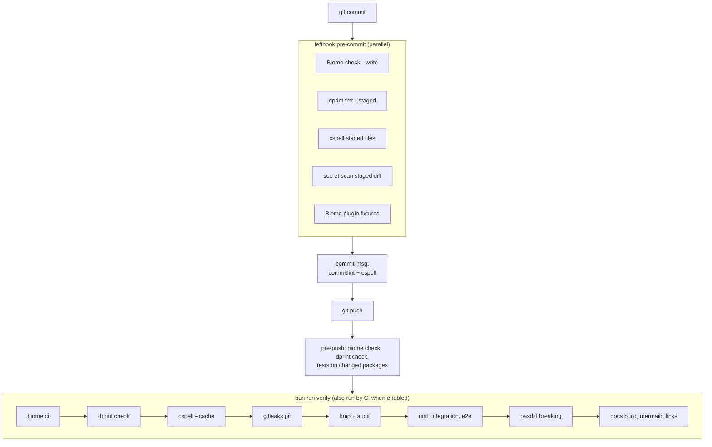

### D12. Docs app and e2e-generated KB
Sources: [Expressive Code](https://expressive-code.com/installation/) (built into Starlight, Shiki default), [astro-mermaid](https://github.com/joesaby/astro-mermaid) 1.4.0 (peer `astro >=4`, `mermaid ^10 || ^11 || ^12`, must be registered before `starlight()`).
E2E scenarios are narratives. The recorder captures HTTP and MCP exchanges, applies masking and the secret scrubber, and writes MDX into the content collection. A failing scenario writes nothing, so published docs are verified by construction. `verify` scans generated MDX with the secret scanner. Diagram source in the repo is always Mermaid and is parse-checked (see Diagram verification).

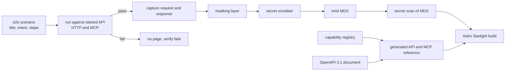

### D13. Observability on Bun
Sources: [pino redaction](https://github.com/pinojs/pino/blob/main/docs/redaction.md), [pino transports](https://github.com/pinojs/pino/blob/main/docs/transports.md), [pino bundling](https://github.com/pinojs/pino/blob/main/docs/bundling.md), [Bun Node compatibility](https://bun.com/docs/runtime/nodejs-compat), [Bun issue #32157](https://github.com/oven-sh/bun/issues/32157), [opentelemetry-js runtimes](https://github.com/open-telemetry/opentelemetry-js#supported-runtimes).
pino `redact` uses an explicit path list (wildcards cost more; paths never come from user input) exported by the masking package. Because pino transports use worker threads, Bun's `worker_threads` is partial, and issue #32157 reports a transport hang, the logger writes JSON synchronously to stdout and avoids worker-thread transports; pretty printing is a dev-time pipe. The service is not bundled in a way that bakes `thread-stream` paths. OpenTelemetry JS does not list Bun as a supported runtime, so we use the OTel API and SDK from the main thread with manual spans and add trace and span ids to log bindings explicitly. Each capability call is a span with transport, principal kind, policy outcome and cache-hit attributes.

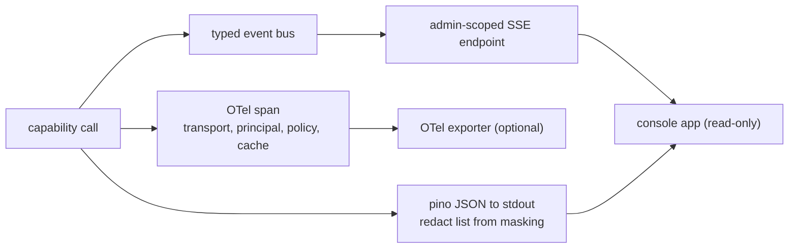

### D14. Console app: existing UI libraries, nothing from scratch
Sources compared on 2026-10-31: [Refine](https://refine.dev/docs/) ([live provider](https://refine.dev/core/docs/realtime/live-provider/), MIT), [react-admin](https://marmelab.com/react-admin/) (MIT, MUI, realtime is Enterprise only), [shadcn/ui](https://ui.shadcn.com/docs) ([chart](https://ui.shadcn.com/docs/components/base/chart) on Recharts v3, [data table](https://ui.shadcn.com/docs/components/base/data-table) guide on TanStack Table v9, MIT), [TanStack Table](https://tanstack.com/table/latest) (headless, type-safe, MIT), [Recharts](https://recharts.github.io/) (v3.10.1, MIT), [Mantine](https://mantine.dev/) (v9.7.4, MIT, `@mantine/charts`), [Tremor](https://www.tremor.so/) (Apache-2.0, "joining Vercel", small repo), [satnaing/shadcn-admin](https://github.com/satnaing/shadcn-admin) (MIT reference UI; explicitly not a starter; partial Clerk auth).

| Option | Fit |
|---|---|
| Refine (headless) + shadcn/ui + Recharts + TanStack Table | Chosen. Refine supplies routing, `authProvider` and `dataProvider` structure and a `liveProvider` shape (`subscribe`, `unsubscribe`); shadcn/ui supplies the components, charts and table; all MIT, strictly typed TSX |
| shadcn/ui + TanStack only | Lighter fallback if Refine adds more than it saves |
| react-admin | Rejected: MUI-centric, realtime paid |
| Mantine | Viable alternative, but no official data table |
| Tremor | Rejected: acquisition and low activity signals |

No candidate offers SSE out of the box (Refine names Ably, Supabase, Appwrite and Hasura as built-in live providers), so a small `liveProvider` adapter over `EventSource` is the only custom piece; the console never publishes. Details of Refine's `authProvider` were only partly readable, so the console auth wiring is an acceptance test. Read-only by construction: only `list` and `getOne` data-provider methods are implemented. Auth for the console is unchanged from the API: the same bearer JWT with the `admin` scope, obtained through the authorization-code flow with PKCE at the configured provider and held in memory only. With Better Auth, the `admin` plugin's default roles `admin` and `user` map to the scope claim.

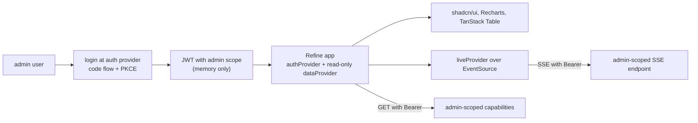

### D15. Persistence POC
Sources: [Bun Drizzle guide](https://bun.sh/docs/guides/ecosystem/drizzle), [Better Auth Drizzle adapter](https://www.better-auth.com/docs/adapters/drizzle), [SQLite adapter](https://www.better-auth.com/docs/adapters/sqlite). `bun:sqlite` with Drizzle's `bun-sqlite` adapter; migrations generated by `drizzle-kit generate`, committed, applied by the Drizzle migrator; Better Auth's tables are generated into the same schema. `drizzle-kit push` is not used outside local experiments. Example domain: `publishers/{publisher}/books/{book}` with soft delete, a state transition, a batch method and one long-running operation.

### D16. CI: GitHub Actions committed but disabled
Sources: GitHub docs on [workflow syntax](https://docs.github.com/en/actions/reference/workflows-and-actions/workflow-syntax), [disabling workflows](https://docs.github.com/en/actions/managing-workflow-runs-and-deployments/managing-workflow-runs/disabling-and-enabling-a-workflow), [variables](https://docs.github.com/en/actions/learn-github-actions/variables), [security hardening](https://docs.github.com/en/actions/security-for-github-actions/security-guides/security-hardening-for-github-actions); [oven-sh/setup-bun](https://github.com/oven-sh/setup-bun), [actions/checkout](https://github.com/actions/checkout), [actions/cache](https://github.com/actions/cache).
The workflow files live in `.github/workflows/` with `on: workflow_dispatch` as the only trigger (no `push` or `pull_request`), `permissions: contents: read`, and every job gated with `if: ${{ vars.CI_ENABLED == 'true' }}` (an unset variable evaluates to an empty string, so jobs are skipped). Turning CI on later means setting the repository variable and adding triggers; no workflow rewrite. Actions are pinned to full commit SHAs with the tag in a comment (the hardening guide recommends SHA pinning), using `oven-sh/setup-bun@v2` with the Bun version read from `package.json`. Because CI is off, the same checks are one local command, `bun run verify`, and the pre-push hook is the enforced gate in the meantime. Workflow-dispatch runs only exist for workflows on the default branch; GitHub's behavior for workflows with no triggers was not verified and is not relied on.

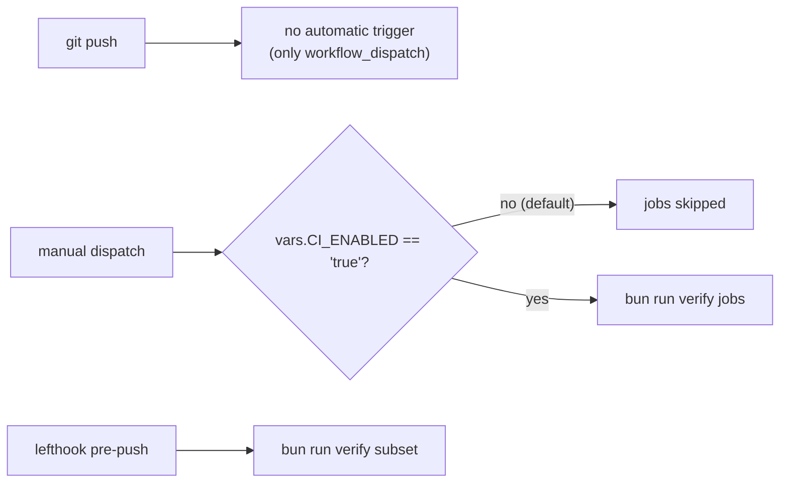

### D17. License
Left empty by decision of the owner. No `LICENSE` file is added, `package.json` omits the `license` field, and workspace packages are `private: true` so nothing can be published by accident.

### D18. One home for types: Zod schemas and contracts in `packages/types`
Rejected in review: the first implementation declared interfaces, type aliases and literal unions inside each package. The rule is now absolute. Closed sets of strings are real TypeScript `enum`s in `packages/constants` (the `MessageId`, `EnvVar`, `ErrorReason`, `HookJob` sets included). Data shapes are Zod schemas in `packages/types` with their types inferred (`AppConfig`, `ConfigIssue`, `Principal`, `FilterNode`, ...); behavioral contracts (interfaces with methods: `AuthProvider`, `RateLimiter`, `PolicyEngine`, `ResponseCache`, `Capability`, ...) are declared in `packages/types/src/contracts`. Enforcement is blocking in pre-commit and `verify` through three Biome GritQL plugins, with node names verified in Biome 2.6.4: `TsInterfaceDeclaration`, `TsTypeAliasDeclaration` and `TsObjectType` outside `packages/types` (`no-local-types.grit`), and `TsStringLiteralType` everywhere (`no-string-literal-types.grit`). Recursive shapes use Zod getters, which type-check without annotations.

### D19. Structure rules: two levels of nesting, flat tests
`tooling/scripts/check-structure.ts` parses every TypeScript file with `oxc-parser` (TypeScript 7 no longer ships the JS compiler API). Per function it allows at most two levels of control flow (`if`, `switch`, loops, `try`) and block-bodied callbacks (an `else if` chain counts as one level; `expect(...)` callbacks and expression-bodied callbacks do not count), and at most two levels of object literals. In test files it forbids loops, conditionals, `switch` and `try` entirely, which forces `test.each` tables and `thrownBy` instead of `try`. Tests must assert behavior; filler tests (a table is non-empty, a constant equals itself) were removed.

### D20. Every rule is registered and blocking
`RULE_JOBS` (constants) maps each `DevRule` to the lefthook jobs that enforce it and `JOB_VERIFY_STEPS` maps each job to the `verify` step that repeats it. `check-rules.ts` fails when a rule names a job that lefthook.yml lacks, and `rules.test.ts` asserts the same plus that no job is warn-only. The tooling scripts themselves obey the string, type and nesting rules: their vocabulary (commands, paths, messages) lives in constants and the message catalog. Test support is a documented exception for strings only (`testkit` and test files hold fixture data); the type rules apply to them.

### D21. Async, lazy and bounded; no comments
Added after review: the first implementation used synchronous file APIs in the tooling, process-lifetime `Map`s in the rate limiter, cache, operation store, idempotency store and capability registry, and carried explanatory comments throughout. Both are now blocking rules in the `structure` job (pre-commit and `verify`), implemented in `tooling/scripts/rules-hygiene.ts` over the `oxc-parser` AST:
- `sync-api`: any call whose name ends in `Sync`.
- `eager-collection`: `new Map`, `Set`, `WeakMap` or `WeakSet` at module level, in a class field or in a constructor, except in `packages/store`.
- `no-comments`: every comment, directives included; YAML `#` comments too. Exceptions live in tool configuration. `strip-comments.ts` wipes comments from staged files in pre-commit before formatting.
- Warnings only (modules and imports may be loose): `eager-invocation` for module-level calls and `heavy-import` for static imports of heavy modules, with an ignore list in constants.
`packages/store` provides `BoundedStore` (mandatory `maxEntries`, optional TTL, LRU eviction, atomic `update`) and `lazy()`. `CapabilityRegistry` now registers loaders and resolves each capability on first use into a bounded store, so adapters call `await registry.get(id)` and `await registry.list()`.

### Repository layout

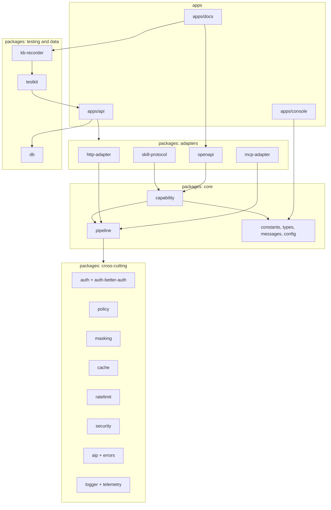

## Diagram verification

All diagrams are Mermaid. Each fenced `mermaid` block in `proposal.md`, `design.md` and every spec is parsed with `mermaid.parse` (mermaid 12.2.0 under jsdom) before the change is committed; the same check is a `verify` task so docs diagrams cannot rot. This is a parse check; visual rendering is confirmed when the docs app builds.

## Risks / Trade-offs

- [SDK `attach` for skills is experimental; Skills extension is new] → Pin versions; isolate in `skill-protocol`; conformance tests with SEP-2640 examples.
- [Better Auth documents no global off switch, and no `Bun.serve` example] → Own enablement flag; integration test of the auth handler, JWT issuance and JWKS verification under Bun; the generic `jwks` provider remains available against any OIDC issuer.
- [JWT access tokens cannot be revoked server-side] → Short lifetimes; refresh tokens; documented limitation.
- [Single resource identifier for HTTP and MCP may not satisfy every MCP client] → `auth.resource` is configurable; conformance test with the SDK client.
- [`:verb` path rewriting could mis-handle ids or collide with real routes] → One rewrite function with exhaustive tests; ids validated by an AIP-122-style rule that excludes `:`.
- [Policy and masking drift between transports] → Adapters cannot import them; contract tests run every capability through both transports.
- [Cache leaks across principals] → Scope in the cache key, pre-mask storage, `private` cache hints for per-caller lists.
- [GritQL plugin is noisy or misses cases; parent conditions undocumented] → Fixture suite is the contract; path `includes`; reviewed suppressions with reasons; pin Biome (CST node names can change between versions).
- [Two formatters conflict (Biome also formats Markdown and YAML)] → Explicit Biome includes negations and dprint-only plugin list; idempotency test over a fixture with every file type.
- [dprint and cspell are undocumented under Bun] → Smoke tests under `bunx`; fallback `npx` on Node 22+.
- [CI disabled means no remote enforcement] → `bun run verify` and the pre-push hook carry the gate; enabling CI is a variable flip.
- [No SSE support in any admin UI library] → One small `liveProvider` adapter; the rest is stock library code.
- [pino or OTel misbehave on Bun] → Synchronous logging, manual spans, shutdown smoke test.
- [Secret scanner is in maintenance mode] → Wrapper script and fixture tests make it swappable.
- [KB recording leaks secrets into docs] → Masking, scrubber, scan of generated MDX in `verify`.
- [Scope is large] → Task list ordered so each package is usable and tested before the next depends on it.

## Migration Plan

Greenfield; no migration. Delivery order: tooling and hooks (Biome, dprint, cspell, secrets, disabled CI), constants/types/messages/config, capability core and pipeline, AIP package, auth and security, policy and masking, HTTP adapter and OpenAPI, MCP adapter and skills, persistence, observability, docs and KB, console. Rollback is reverting the change.

## Decided With the Owner

| Topic | Decision |
|---|---|
| Biome and dprint | Mandatory, enforced in hooks and `verify` |
| Authentication | Switchable by config; authless capabilities supported; Hono uses Better Auth with JWT when enabled |
| Production authorization | Depends on the implementation a deployer plugs in; `jwks` provider for external issuers |
| CI | GitHub Actions committed, disabled by default |
| Console auth | Same bearer JWT with `admin` scope; UI built from existing libraries |
| License | Left empty |

## Open Questions and Outcomes

Every question is resolved. Each outcome names the test or check that holds it.

| # | Question | Outcome | Evidence |
|---|---|---|---|
| 1 | Auth field on the `SkillSource` `ctx` | The installed SDK declares the token on `ctx.http?.authInfo`; there is no `ctx.authInfo`. `getPrincipal(ctx)` reads it and falls back to anonymous. | `packages/skill-protocol` tests: anonymous `skills/list` shows only authless skills |
| 2 | Published versions of `@modelcontextprotocol/hono`, `@hono/zod-openapi` | Pinned exactly: `@modelcontextprotocol/server` 2.4.0, `@modelcontextprotocol/hono` 2.0.2, `@hono/zod-openapi` 1.6.3; the lockfile is committed | `bun install --frozen-lockfile` and `bun audit` in `verify` |
| 3 | Parent-scoped conditions in Biome GritQL | `not $s <: within <Node>()` works in 2.6.4; positions are pinned by fixtures | `tooling/scripts/plugin-fixtures.test.ts` |
| 4 | Better Auth on Bun | Works: handler, JWT plugin, `bun:sqlite` through Drizzle | `packages/auth-better-auth` integration tests |
| 5 | Drizzle adapter import path | The pinned package decides; the build fails if it is wrong | typecheck and the Better Auth tests |
| 6 | CIMD fetch transport on Bun | `@better-auth/cimd/node` works under Bun and is used unchanged | `cimd` tests |
| 7 | Refine `authProvider` and `liveProvider` | `check`, `getIdentity`, `logout` over an in-memory bearer token; a custom live provider. Deviation: it reads the stream with `fetch`, not `EventSource`, because `EventSource` cannot send an `Authorization` header and tokens never go in the query string. Refine stayed because it supplies the provider structure at a small cost | `apps/console/dom` tests: no admin scope means no data; live row appears on an event |
| 8 | Single resource identifier for HTTP and MCP | The API origin is the resource for both; a token issued for another resource is rejected on both transports | `packages/mcp-adapter` and `apps/api` tests with the SDK client |
| 9 | Staged-scan command for the secret scanner | `git diff --cached` through `gitleaks stdin` in pre-commit, `gitleaks git` in `verify` | secret scan gate tests |
| 10 | pino and OTel shutdown on Bun | Synchronous logger; the signal handler stops the server and shuts the telemetry providers down; exit code 0 with logs flushed | `apps/api/src/main.test.ts` |
| 11 | Behavior of a workflow with no triggers | Not relied on; `workflow_dispatch` plus the variable gate | workflow lint in `verify` |

## Findings From Implementation

Recorded while building group 5; each is covered by a test.

- Better Auth 1.7.14 runs under Bun: the handler, EdDSA JWKS, sign-up, the OAuth token endpoint and the schema CLI (`bun x --bun auth@latest generate`) all work, and the integration tests run against a real `Bun.serve` instance.
- Token issuer is `<origin>/api/auth`, and the `mcp` plugin serves the RFC 9728 document at `/.well-known/oauth-protected-resource` with `resource` equal to the origin, matching decision D3. The `jwks` provider is configured with that issuer.
- The OAuth provider is strict by default: scopes must be declared on the plugin; `client_credentials` tokens need a server-owned scope ceiling set at client creation (`client_credentials_scopes`), which in turn needs a `clientPrivileges` callback. The platform allows only users with the `admin` role to create or configure clients.
- Web clients need HTTPS redirect URIs (even for loopback hosts); native clients are the loopback exception.
- Dynamic client registration is off and `/token` is disabled, both asserted by tests.
- `drizzle-kit` pulled in an `esbuild` version with a moderate advisory; the root `overrides` pin `esbuild` to 0.25.12, and `bun audit` is clean.

Recorded while building groups 7 and 8:
- Open question 1 is resolved: the installed SDK declares the caller's token on `ctx.http?.authInfo` (there is no `ctx.authInfo`), and `getPrincipal(ctx)` reads exactly that.
- A tool call with invalid arguments returns an `isError` result rather than a protocol error; an unknown tool is `-32602`. A request whose `Mcp-Method` header disagrees with the body is `400` with `-32020`.
- `createMcpHonoApp` validates the `Host` header, so MCP tests run against a real `Bun.serve` instance.
- Published versions pinned: `@hono/zod-openapi` 1.6.3, `@modelcontextprotocol/server` 2.4.0, `@modelcontextprotocol/hono` 2.0.2, `oasdiff` 1.35.0 (open question 2).
