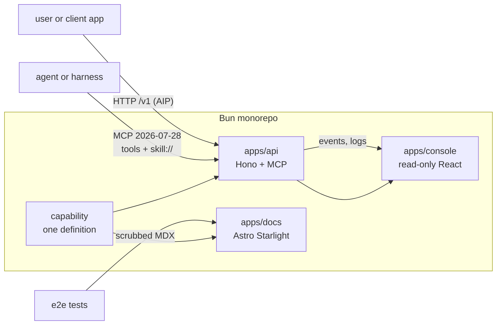

## Why

APIs, MCP servers, OpenAPI documents, agent skills and documentation are usually authored separately and drift apart. Policy and data-masking rules get implemented once per transport and diverge. This change creates a Bun monorepo in which an endpoint is declared **once** as a capability and projected into HTTP, MCP, OpenAPI, `skill://` resources and generated docs, with one shared pipeline enforcing auth, policy, rate limits, caching and masking. The MCP 2026-07-28 revision (stateless Streamable HTTP), the Skills extension (SEP-2640, Final) and the official TypeScript SDK v2 (which ships a Skills extension and a Hono helper) make this practical now.

## Overview

## Key Decisions

Full reasoning, alternatives and links are in `design.md`.

| Decision | Choice |
|---|---|
| MCP server | Official TypeScript SDK v2, used directly (D1) |
| Skills | SDK Skills extension with a registry-fed `SkillSource` (D4) |
| Capability model | One Zod 4 definition projected to HTTP, MCP, OpenAPI, skills, docs (D6) |
| Policy and masking | Two separate middlewares, each optional per capability (D7) |
| API style | Google AIP over JSON/HTTP, lowerCamelCase wire format, `/v1` path versioning (D8) |
| `:verb` custom methods | Path-rewriting wrapper, not Hono syntax (D8) |
| Authentication | Switchable by config; every capability declares `none`, `optional` or `required`; authless capabilities are first-class (D3) |
| Auth implementation | Pluggable `AuthProvider`; Better Auth with the JWT plugin is the shipped provider, a generic `jwks` provider covers external OIDC issuers; production auth depends on what a deployer plugs in (D3) |
| Raw strings | Dedicated packages; a Biome v2 GritQL plugin is the mandatory gate (D10) |
| Formatting | Biome and dprint are both mandatory; Biome owns JS/TS/JSON/CSS/GraphQL, dprint owns Markdown, TOML, YAML, Dockerfile (D11) |
| Spelling | cspell 10 is mandatory in hooks and `verify` (D11) |
| Secrets | gitleaks behind a swappable wrapper, plus secretlint (D11) |
| CI | GitHub Actions committed but disabled (`workflow_dispatch` plus `vars.CI_ENABLED` gate); `bun run verify` runs the same checks locally (D16) |
| Console | Refine (headless) + shadcn/ui + Recharts + TanStack Table, read-only; same bearer JWT with `admin` scope (D14) |
| License | Left empty by the owner (D17) |
| Logging and telemetry | pino synchronous to stdout, OTel manual spans on Bun (D13) |
| Persistence | `bun:sqlite` + Drizzle, POC only (D15) |
| Diagrams | Mermaid only, parse-checked in CI (design, Diagram verification) |

## What Changes

- New Bun workspace monorepo: `apps/api`, `apps/docs`, `apps/console`, plus focused `packages/*` and `tooling/*`.
- A `defineCapability()` core: one Zod 4 definition carries id, AIP resource and method kind, input/output schemas, field behavior, docs, examples, version, and **optional** `policy`, `mask`, `cache`, `rateLimit` declarations.
- Transport-agnostic pipeline (auth → rate-limit → policy → validate → cache → handler → mask → observe) mounted by thin HTTP (Hono) and MCP adapters.
- **Policy** and **masking** are two independent middlewares, each opt-in per capability.
- MCP server on the official SDK v2 (`createMcpHandler`, `@modelcontextprotocol/hono`), serving 2026-07-28 and, through the SDK's stateless fallback, the 2025 era. `tools/list` and `skills/list` are filtered by the caller's authorization.
- Skills served through the SDK's `@modelcontextprotocol/server/ext/skills` (`SkillSource`, `skillEntry`) with `skill://` URIs, generated from the capability registry.
- Self-declared OpenAPI 3.1 and MCP tool schemas generated from the same Zod definitions; `oasdiff` breaking-change gate.
- Google AIP conformance for a JSON/HTTP API (see Research Basis for the exact AIP list and decisions).
- No raw strings: enums/`as const` unions in dedicated shared type packages, a message catalog package, a typed config package. Enforced by a mandatory Biome GritQL plugin with a fixture suite.
- Tests: unit, integration, e2e. E2E runs record scrubbed request/response transcripts that are emitted as KB MDX.
- Astro Starlight docs app (API reference, KB, Expressive Code/Shiki highlighting, Mermaid).
- Authentication that can be switched on or off by config, with explicit per-capability `none`/`optional`/`required` modes. When enabled, Hono uses Better Auth with JWT access tokens; the same verifier feeds the MCP endpoint as `authInfo`. Production auth depends on the provider a deployer plugs in.
- Read-only React console built from existing libraries (Refine, shadcn/ui, Recharts, TanStack Table): live request stream, logs, per-capability stats, policy decisions.
- Observability: pino with shared redaction list, OpenTelemetry (API/SDK, manual spans).
- POC persistence: `bun:sqlite` + Drizzle with committed migrations. Skeleton only.
- Engineering gates, all mandatory: Biome v2 (format + lint for JS/TS/JSON/CSS, including the raw-string GritQL plugin), dprint (Markdown, TOML, YAML, Dockerfile), cspell, lefthook pre-commit/pre-push, secret scanning, commitlint, oasdiff, knip. One `bun run verify` command runs everything.
- GitHub Actions workflows are committed but disabled (manual trigger plus a repository-variable gate).
- No license file is added; the owner decides later.
- All documentation diagrams are Mermaid and are parse-checked.

## Capabilities

### New Capabilities
- `capability-core`: `defineCapability()`, registry, shared pipeline contract and the optional per-capability declarations.
- `http-adapter`: Hono projection of capabilities, AIP routing including `:verb` custom methods.
- `mcp-adapter`: MCP server on SDK v2, tool projection, auth-filtered listing, cache hints, OAuth resource-server behavior.
- `skill-protocol`: Skills extension (`skills/list`, `skills/get`, `skill://` URIs, digests) and `SKILL.md` generation.
- `policy-engine`: allow/deny decisions for users and agents, per capability, with decision events.
- `masking-layer`: field-level output masking, independent of policy, applied to HTTP and MCP output.
- `authentication`: switchable auth, per-capability auth modes including authless, `AuthProvider` interface, Better Auth + JWT provider, generic JWKS provider, Protected Resource Metadata.
- `security-middleware`: rate limiting, caching and security headers shared by both transports.
- `aip-conformance`: resource names, standard and custom methods, pagination, filtering, field masks, LRO, batch, etag, idempotency, versioning, error model.
- `openapi-generation`: OpenAPI 3.1 document from the registry, security schemes, breaking-change gate.
- `typed-constants`: shared enums/const types packages, message catalog, typed config; ban on raw strings.
- `testing-and-kb`: unit/integration/e2e harness and KB recorder with secret scrubbing.
- `docs-site`: Astro Starlight app consuming generated OpenAPI, MCP and KB output.
- `observability`: pino logging with redaction, OpenTelemetry traces and metrics, in-process event bus.
- `console-app`: read-only React visualization of events, logs and stats.
- `dev-standards`: Biome, lefthook hooks, secret and leak prevention, spell check, commit and dependency hygiene.
- `persistence-poc`: SQLite + Drizzle schema and migrations for the example domain.

### Modified Capabilities

## Research Basis

Research was done on 2026-10-31 by reading primary sources. A first pass was wrong about FastMCP and is corrected here.

### MCP and skills

| Finding | Source |
|---|---|
| MCP 2026-07-28 removes sessions, the `initialize` handshake, the GET stream and SSE resumability; adds `server/discover`; requires `MCP-Protocol-Version`, `Mcp-Method`, `Mcp-Name` headers | [Changelog](https://modelcontextprotocol.io/specification/2026-07-28/changelog), [Streamable HTTP](https://modelcontextprotocol.io/specification/2026-07-28/basic/transports/streamable-http) |
| `tools/list` may vary by authorization; list and read results MUST carry `ttlMs` and `cacheScope` (`public` or `private`) | [Tools](https://modelcontextprotocol.io/specification/2026-07-28/server/tools), [Caching](https://modelcontextprotocol.io/specification/2026-07-28/server/utilities/caching.md) |
| Servers are OAuth 2.1 resource servers; MUST publish RFC 9728 Protected Resource Metadata (`resource`, and per MCP at least one `authorization_servers`); well-known path is `/.well-known/oauth-protected-resource` with the resource path appended, for example `/.well-known/oauth-protected-resource/mcp` | [Authorization](https://modelcontextprotocol.io/specification/2026-07-28/basic/authorization), [AS discovery](https://modelcontextprotocol.io/specification/2026-07-28/basic/authorization/authorization-server-discovery.md), [RFC 9728](https://www.rfc-editor.org/rfc/rfc9728) |
| Resource-not-found is `-32602` (not `-32002`); new codes `-32020`, `-32021`, `-32022` | [Resources](https://modelcontextprotocol.io/specification/2026-07-28/server/resources) |
| Skills extension (SEP-2640, Final): id `io.modelcontextprotocol/skills`, `skill://<path>/SKILL.md`, `skills/list`, `skills/get`, sha256 digests, 512 files / 16 MiB per skill. It defines no `skill://index.json` | [SEP-2640](https://github.com/modelcontextprotocol/modelcontextprotocol/blob/main/seps/2640-skills-extension.md) |
| Official TypeScript SDK v2 (`@modelcontextprotocol/server` 2.4.0 on main) runs on Node, Bun and Deno; `createMcpHandler` returns a Fetch handler serving both protocol eras; `createMcpHonoApp` from `@modelcontextprotocol/hono`; Zod 4 via Standard Schema | [Repo](https://github.com/modelcontextprotocol/typescript-sdk), [Hono serving](https://ts.sdk.modelcontextprotocol.io/v2/serving/hono.html), [createMcpHandler](https://ts.sdk.modelcontextprotocol.io/v2/api/) |
| The SDK ships a Skills extension: `loadSkills`, `SkillsExtension`, `SkillSource` (every method receives `ctx`, so listing can differ per caller), `skillEntry`, `cacheHint`; marked experimental | [Skills guide](https://ts.sdk.modelcontextprotocol.io/v2/servers/skills.html) |
| SDK auth: `requireBearerAuth`, `oauthMetadataResponse`, per-operation `scopeChallenge`; the handler does no token verification itself and takes `authInfo` per request | [Authorization](https://ts.sdk.modelcontextprotocol.io/v2/serving/authorization.html) |

### FastMCP: three different projects

| Project | MCP 2026-07-28 | Skills | Language | Verdict |
|---|---|---|---|---|
| [FastMCP (Python), gofastmcp.com](https://gofastmcp.com/servers/skills) | Yes, 4.x serves both eras | Yes, `SkillCatalogProvider`, `SkillsDirectoryProvider`; page says "New in 4.2.0", experimental; no `directoryRead` | Python | Good fit by features, wrong runtime for a Bun/TypeScript monorepo. Its design (per-component `auth=`, `AuthMiddleware`, visibility, versioning) is a useful reference for ours |
| [PrefectHQ/fastmcp-ts](https://github.com/PrefectHQ/fastmcp-ts) | Yes, README states both eras | Not mentioned | TypeScript, built on the official SDK v2 | Candidate wrapper; no documented Hono mounting or skills; its middleware overlaps our pipeline |
| [punkpeye/fastmcp](https://github.com/punkpeye/fastmcp) | No, up to 2025-11-25 only | No | TypeScript | Rejected |

Decision: use the official SDK v2 directly; the shared pipeline provides the cross-cutting layers, so a wrapper adds a second middleware system.

### Google AIP

Read from google.aip.dev. AIP-137 does not exist; AIP-162 is Draft and is not adopted. Decisions in parentheses.

| AIP | Rules adopted | Decision for this repo |
|---|---|---|
| [121](https://google.aip.dev/121) | Resource hierarchy; Get and List on every resource; prefer standard methods; stateless; reference graph is a DAG | One capability per standard method per resource |
| [122](https://google.aip.dev/122) | `/`-separated names, plural camelCase collections, `name` field holds the full name, ids RFC-1034-like, version not in name | `name` is the only identifier field; `displayName` for labels |
| [127](https://google.aip.dev/127) | Unbound request fields become query params; no body on GET/DELETE; avoid `PUT`; clients use camelCase on the wire | Wire JSON is lowerCamelCase per ProtoJSON; snake_case input also accepted, matching [ProtoJSON parsers](https://protobuf.dev/programming-guides/json/) |
| [131](https://google.aip.dev/131) [132](https://google.aip.dev/132) [133](https://google.aip.dev/133) [134](https://google.aip.dev/134) [135](https://google.aip.dev/135) | Get `GET`; List `GET` with `pageSize`, `pageToken`, optional `orderBy`, `filter`, `showDeleted`; Create `POST` with `{resource}Id` as query param and `name` in body ignored; Update `PATCH` with `updateMask`, omitted mask means all populated fields, `allowMissing`, `etag` mismatch is `ABORTED`; Delete `DELETE`, no body, `force` for parents with children, `FAILED_PRECONDITION` otherwise | Delete returns `200 {}` (ProtoJSON `Empty`) |
| [136](https://google.aip.dev/136) | Custom methods use `:verb`; `POST` for side effects, `GET` for reads; verb-noun, no prepositions, no standard verbs, no `Async`; `body: "*"` | Hono cannot express a dynamic `:verb` suffix reliably, so the HTTP adapter rewrites the request path before routing (see design D8) |
| [140](https://google.aip.dev/140) [141](https://google.aip.dev/141) [142](https://google.aip.dev/142) [143](https://google.aip.dev/143) | Field naming, quantities with unit suffix and `_count`, `*_time` timestamps (RFC 3339), duration strings like `1.5s`, `regionCode`, `currencyCode`, `languageCode`, `timeZone` | Shared Zod primitives in `aip` package |
| [146](https://google.aip.dev/146) | Prefer `oneof`, then maps, then Struct; avoid `Any` | Zod discriminated unions; no free-form payloads in v1 |
| [151](https://google.aip.dev/151) | Slow methods return an `Operation` (`name`, `done`, `metadata`, `response`, `error`); start failures are normal errors; execution failures go in `error`; expiry about 30 days | `GET /v1/operations/{id}` capability |
| [154](https://google.aip.dev/154) [155](https://google.aip.dev/155) | `etag` string (quoted, `W/` for weak), mismatch is `ABORTED`; optional `requestId` UUID gives idempotency and replays the earlier success | Both supported; `requestId` stored with TTL |
| [156](https://google.aip.dev/156) | Singletons have no Create/Delete, may have Get/Update | Used for per-tenant config examples |
| [157](https://google.aip.dev/157) | `view` enum (`BASIC`, `FULL`), List defaults to BASIC | `view` query param |
| [158](https://google.aip.dev/158) | Pagination from day one; `pageSize` negative is `INVALID_ARGUMENT`; opaque URL-safe tokens; empty `nextPageToken` ends the collection | Defaults and maxima come from config |
| [160](https://google.aip.dev/160) | `filter` with `AND`, `OR`, `NOT`/`-`, comparisons, `:` has; unknown fields are `INVALID_ARGUMENT` | Parsed to a typed AST over an allowlist of fields per capability; never raw SQL |
| [161](https://google.aip.dev/161) | Masks relative to the resource, `.` traversal, no indexes into repeated fields; ProtoJSON wire form is a comma-separated string of camelCase paths | `updateMask=title,author.givenName` |
| [163](https://google.aip.dev/163) | `validateOnly` runs all checks without executing | Supported on mutating capabilities |
| [164](https://google.aip.dev/164) | Soft delete with `deleteTime`, `purgeTime`, `:undelete`, `:expunge` | Example domain implements soft delete |
| [180](https://google.aip.dev/180) [181](https://google.aip.dev/181) [185](https://google.aip.dev/185) | No breaking changes inside a major version; major version first in the path; `v1beta` for beta; no minor versions | Path versioning only; the date-based `X-Goog-Api-Version` header is not adopted |
| [193](https://google.aip.dev/193) | Body `{ "error": { code, message, status, details } }`; `code` is the HTTP status; every error has `ErrorInfo` (`reason` matches `[A-Z][A-Z0-9_]+[A-Z0-9]`, `domain`, `metadata`); permission checked before existence | Code-to-HTTP table taken from [code.proto](https://github.com/googleapis/googleapis/blob/master/google/rpc/code.proto) |
| [194](https://google.aip.dev/194) | Retry `UNAVAILABLE`; do not retry `INVALID_ARGUMENT`, `DEADLINE_EXCEEDED`, `CANCELLED`, `DATA_LOSS`; generally not `RESOURCE_EXHAUSTED` | Documented in the KB; 429 also sends `Retry-After` |
| [203](https://google.aip.dev/203) | Every request field annotated `REQUIRED`, `OPTIONAL` or `OUTPUT_ONLY`; `IMMUTABLE`, `INPUT_ONLY`; output-only fields ignored in masks | Zod `.meta()` field behavior, mapped to OpenAPI `readOnly`/`writeOnly` |
| [210](https://google.aip.dev/210) | ASCII ids, NFC for Unicode, limits in code points | Validators in `aip` package |
| [216](https://google.aip.dev/216) | `State` enum, output-only, transitions by `POST :verb` that fail with `FAILED_PRECONDITION` | Used for publish/archive transitions |
| [231](https://google.aip.dev/231) [233](https://google.aip.dev/233) [234](https://google.aip.dev/234) [235](https://google.aip.dev/235) | Batch methods end in `:batchGet` (`GET`), `:batchCreate`, `:batchUpdate`, `:batchDelete` (`POST`); synchronous batches are atomic | One batch capability set in the example domain |

### Authentication (Better Auth)

| Finding | Source |
|---|---|
| Hono mount: `app.all("/api/auth/*", c => auth.handler(c.req.raw))`, registered before catch-all routes; CORS before it with `credentials: true` and an explicit origin plus `trustedOrigins`; default `basePath` `/api/auth`, configurable; session middleware via `auth.api.getSession({ headers })` | [Hono integration](https://www.better-auth.com/docs/integrations/hono) |
| JWT plugin: default EdDSA (Ed25519), 15-minute expiry, JWKS at `/api/auth/jwks`, key rotation options, `definePayload`, verification with jose `createRemoteJWKSet` and `jwtVerify` (issuer, audience); `/token` must be disabled when MCP or OIDC plugins issue tokens | [JWT plugin](https://www.better-auth.com/docs/plugins/jwt) |
| MCP plugin targets the MCP 2026-07-28 profile; requires the JWT plugin; `resource` becomes the token `aud`; `requireMcpAuth` and `createMcpProtectedRequestHandler`; PRM and AS metadata served automatically; DCR off by default (deprecated by MCP), CIMD recommended; on Bun CIMD needs an injected transport; scopes enforced, 403 `insufficient_scope` | [MCP plugin](https://www.better-auth.com/docs/plugins/mcp) |
| OAuth provider: PKCE code flow, refresh, client credentials, device code; RFC 8707 `resource` gives per-token `aud`; JWT access tokens cannot be revoked server-side; `verifyAccessTokenRequest` helper | [OAuth provider](https://www.better-auth.com/docs/plugins/oauth-provider) |
| Bearer plugin returns the session token (not a JWT) in `set-auth-token`; docs warn to use cautiously | [Bearer](https://www.better-auth.com/docs/plugins/bearer) |
| Admin plugin default roles `admin` and `user`, custom access control, `userHasPermission`; API key plugin with `x-api-key`; organization plugin | [Admin](https://www.better-auth.com/docs/plugins/admin), [API key](https://www.better-auth.com/docs/plugins/api-key), [Organization](https://www.better-auth.com/docs/plugins/organization) |
| `bun:sqlite` supported through the SQLite adapter (Kysely underneath); Drizzle adapter available with `provider: "sqlite"`; CLI `generate --adapter drizzle`; `migrate` only for Kysely | [SQLite](https://www.better-auth.com/docs/adapters/sqlite), [Drizzle](https://www.better-auth.com/docs/adapters/drizzle), [CLI](https://www.better-auth.com/docs/concepts/cli) |
| Security: scrypt hashing, secure httpOnly cookies, CSRF origin checks, `BETTER_AUTH_SECRET` at least 32 characters, secret rotation, built-in rate limit on in production | [Security](https://www.better-auth.com/docs/reference/security), [Options](https://www.better-auth.com/docs/reference/options) |
| Bun: `bun add better-auth`, `bun x auth@latest generate|migrate`, `bunx @better-auth/cli generate` and `bun:sqlite` are documented; no explicit runtime-support statement or `Bun.serve` example (the Hono tab uses `@hono/node-server`). Not documented: a global auth off switch, exact `scope` claim format | [Installation](https://better-auth.com/docs/installation), [Hono example](https://hono.dev/examples/better-auth), [SQLite adapter](https://www.better-auth.com/docs/adapters/sqlite) |
| MIT license, v1.7.14 released 2026-10-26 | [Repo](https://github.com/better-auth/better-auth), [latest release](https://github.com/better-auth/better-auth/releases/latest) |

### Admin UI libraries (read-only console)

| Library | Key facts | Source |
|---|---|---|
| Refine | Headless, MIT; `authProvider`, `dataProvider`, `liveProvider` (`subscribe`, `unsubscribe`, `publish?`); built-in live providers Ably, Supabase, Appwrite, Hasura (no SSE); UI integrations include shadcn/ui, Mantine, Ant Design, MUI | [Docs](https://refine.dev/docs/), [Live provider](https://refine.dev/core/docs/realtime/live-provider/), [License](https://refine.dev/core/docs/further-readings/license/) |
| react-admin | MIT, MUI-centric; realtime updates are in the paid Enterprise edition | [react-admin](https://marmelab.com/react-admin/) |
| shadcn/ui | MIT, copy-in components; charts on Recharts v3; data table is a guide on TanStack Table v9 | [Docs](https://ui.shadcn.com/docs), [Chart](https://ui.shadcn.com/docs/components/base/chart), [Data table](https://ui.shadcn.com/docs/components/base/data-table) |
| TanStack Table | Headless, type-safe, tree-shakable, MIT | [Table](https://tanstack.com/table/latest) |
| Recharts | v3.10.1, MIT, composable SVG charts | [Recharts](https://recharts.github.io/) |
| Mantine | v9.7.4, MIT, `@mantine/charts` on Recharts, no official data table | [Mantine](https://mantine.dev/), [extensions](https://mantine.dev/x/extensions/) |
| Tremor | Apache-2.0, on Recharts and Radix; "joining Vercel"; small repository | [Tremor](https://www.tremor.so/) |
| shadcn-admin template | MIT reference UI, explicitly not a starter, partial Clerk auth | [Repo](https://github.com/satnaing/shadcn-admin) |

No candidate ships SSE; release dates and bearer-JWT specifics were not readable for most of them.

### Tooling

| Finding | Source |
|---|---|
| `@hono/zod-openapi` 1.6.3 (main): peers `hono >=4.10.0`, `zod ^4.0.0`; depends on `@asteasolutions/zod-to-openapi ^9.1.0`; `doc31`/`getOpenAPI31Document`; `app.openAPIRegistry`; `registerComponent('securitySchemes', …)` | [package.json](https://github.com/honojs/middleware/blob/main/packages/zod-openapi/package.json), [README](https://github.com/honojs/middleware/tree/main/packages/zod-openapi) |
| `z.toJSONSchema` defaults to `draft-2020-12`; `io: "input" \| "output"` | [Zod JSON Schema](https://zod.dev/json-schema) |
| Hono has no escape for a literal colon after a parameter; support request [#4562](https://github.com/honojs/hono/issues/4562) is open and the maintainer calls it difficult; a regex workaround in [#1301](https://github.com/honojs/hono/issues/1301) was never confirmed; a static `/v1/name:activate` path does match in the RegExpRouter tests | [Hono routing](https://hono.dev/docs/api/routing) |
| pino `redact` takes paths with `*` wildcards, `censor`, `remove`; it is built on fast-redact; paths must not come from user input | [pino redaction](https://github.com/pinojs/pino/blob/main/docs/redaction.md) |
| pino transports run in worker threads; Bun's `worker_threads` is partial; Bun issue [#32157](https://github.com/oven-sh/bun/issues/32157) reports a pino transport hang on exit; bundling pino with `bun build` needs extra handling | [Transports](https://github.com/pinojs/pino/blob/main/docs/transports.md), [Bundling](https://github.com/pinojs/pino/blob/main/docs/bundling.md), [Bun Node compat](https://bun.com/docs/runtime/nodejs-compat) |
| OpenTelemetry JS lists Node.js versions as supported runtimes; Bun is not listed | [opentelemetry-js](https://github.com/open-telemetry/opentelemetry-js#supported-runtimes) |
| Biome v2 (current stable 2.6.4): GritQL plugins take `plugins` entries with `path` and `includes` (negated globs allowed); `register_diagnostic` takes `span`, `message`, `severity`; CST patterns use `engine biome(1.0)` and `language js(typescript, jsx)`; `biome lint --only=plugin`; `biome search` tests a pattern; `biome ci --changed --since` needs `vcs.defaultBranch` | [Plugins](https://biomejs.dev/linter/plugins/), [Recipes](https://biomejs.dev/recipes/gritql-plugins/), [GritQL reference](https://biomejs.dev/reference/gritql/), [CLI](https://biomejs.dev/reference/cli/), [Configuration](https://biomejs.dev/reference/configuration/), [Changelog](https://biomejs.dev/internals/changelog/) |
| Biome grammar: `JsStringLiteralExpression` is the string expression node; import sources are `JsModuleSource`, member keys `JsLiteralMemberName`, directives `JsDirective`, enum member names `TsLiteralEnumMemberName`, template literals `JsTemplateExpression` (different nodes, so not matched by the base pattern); `require()`, `import()`, computed keys, enum initializers and `as const` still match; no documented `within` condition; no `noRestrictedSyntax` rule | [js.ungram](https://github.com/biomejs/biome/blob/main/xtask/codegen/js.ungram), [rules](https://biomejs.dev/linter/javascript/rules) |
| Biome language support: formats JS, TS, JSX, TSX, JSON, JSONC, CSS, SCSS, YAML, GraphQL, Markdown; HTML, Vue, Svelte, Astro experimental; GritQL plugins on JS/TS/JSON/CSS only; JavaScript plugins are Developer Preview | [Language support](https://biomejs.dev/internals/language-support/) |
| `noRestrictedImports` and `noRestrictedGlobals` options | [noRestrictedImports](https://biomejs.dev/linter/rules/no-restricted-imports/javascript), [noRestrictedGlobals](https://biomejs.dev/linter/rules/no-restricted-globals/javascript) |
| GitHub Actions: `workflow_dispatch` only runs for workflows on the default branch; unset `vars` evaluate to an empty string so a job-level `if: vars.X == 'true'` skips; `gh workflow disable`; pin actions to full SHAs; default `contents: read`; `oven-sh/setup-bun@v2` reads the Bun version from `package.json`; checkout v7, cache v6; gitleaks-action v3 needs a license key only for organization accounts | [Workflow syntax](https://docs.github.com/en/actions/reference/workflows-and-actions/workflow-syntax), [Disabling](https://docs.github.com/en/actions/managing-workflow-runs-and-deployments/managing-workflow-runs/disabling-and-enabling-a-workflow), [Variables](https://docs.github.com/en/actions/learn-github-actions/variables), [Hardening](https://docs.github.com/en/actions/security-for-github-actions/security-guides/security-hardening-for-github-actions), [setup-bun](https://github.com/oven-sh/setup-bun), [checkout](https://github.com/actions/checkout), [cache](https://github.com/actions/cache), [gitleaks-action](https://github.com/gitleaks/gitleaks-action) |
| Biome lefthook recipe: `biome check --write --no-errors-on-unmatched --files-ignore-unknown=true {staged_files}` with `stage_fixed: true`; lefthook `stage_fixed` works only on pre-commit | [Git hooks](https://biomejs.dev/recipes/git-hooks/), [lefthook stage_fixed](https://lefthook.dev/configuration/stage_fixed/) |
| dprint formats via plugins (`dprint fmt`, `dprint check`, `dprint fmt --staged` needs 0.47+, exit code 20 when unformatted); official plugins: TypeScript/JavaScript, JSON, Markdown, TOML, Dockerfile, SQL, Jupyter; community: `pretty_yaml`, Malva (CSS), markup_fmt (HTML/Vue/Svelte/Astro); no MDX plugin listed; `npm install dprint` documented, Bun not mentioned; no documented ESLint or Biome coexistence beyond plugin precedence | [Overview](https://dprint.dev/overview/), [CLI](https://dprint.dev/cli/), [Config](https://dprint.dev/config/), [Plugins](https://dprint.dev/plugins/), [Install](https://dprint.dev/install/), [Markdown plugin](https://dprint.dev/plugins/markdown/) |
| cspell: current major 10; README says Node 22+ (installation page says 18+); config keys `version`, `language`, `words`, `ignorePaths`, `dictionaries`, `dictionaryDefinitions`, `useGitignore`, `failFast`, `cache`, `overrides`, `import`; bundled dictionaries `softwareTerms`, `typescript`, `node`, `npm`; flags `--no-progress`, `--no-must-find-files`, `--file-list`, `--cache`, `--validate-directives`; inline `cspell:ignore`; `bun add --global cspell@latest` documented | [cspell README](https://github.com/streetsidesoftware/cspell/tree/main/packages/cspell), [schema](https://raw.githubusercontent.com/streetsidesoftware/cspell/refs/heads/main/cspell.schema.json), [getting started](https://cspell.org/docs/getting-started), [installation](https://cspell.org/docs/installation) |
| gitleaks README: feature complete, security patches only, author moving to Betterleaks; `protect`/`detect` deprecated; `git`, `dir`, `stdin` commands documented; `--staged` is not in the README | [gitleaks](https://github.com/gitleaks/gitleaks) |
| oasdiff `breaking` with `--fail-on ERR`; OpenAPI 3.1 supported since v1.15.0 with some `$dynamicRef` limits | [oasdiff](https://github.com/oasdiff/oasdiff) |
| Starlight ships Expressive Code (Shiki); `astro-mermaid` 1.4.0 must be registered before `starlight()` | [Expressive Code](https://expressive-code.com/installation/), [astro-mermaid](https://github.com/joesaby/astro-mermaid) |
| Drizzle with `bun:sqlite`, `drizzle-kit generate`, `bun-sqlite` migrator | [Bun guide](https://bun.sh/docs/guides/ecosystem/drizzle) |

## Impact

- New top-level workspace in this repository; no existing code is modified.
- Runtime dependencies: Bun, Hono, `@hono/zod-openapi`, Zod 4, `@modelcontextprotocol/server`, `@modelcontextprotocol/hono`, Better Auth (with the JWT, MCP and admin plugins), jose, Drizzle, pino, OpenTelemetry API/SDK, Astro/Starlight, React, Refine, shadcn/ui, Recharts, TanStack Table.
- Tooling: Biome v2, lefthook, a secret scanner, secretlint, cspell, commitlint, oasdiff, knip.
- Remaining unverified points are few and each has a test as its acceptance criterion; they are listed in `design.md` under Open Questions.
