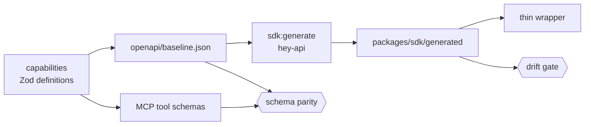

## Context

The platform projects one capability definition into HTTP, MCP, OpenAPI, skills and docs. The SDK is one more projection and must be generated, never authored. The prior hand-built SDK was rejected and removed.

## Goals / Non-Goals

**Goals:**
- Generated client, operation functions and Zod schemas committed under `packages/sdk/generated`.
- Drift between OpenAPI and committed code fails pre-commit and `verify`.
- Real-client evidence for HTTP (SDK) and MCP (official client and Inspector CLI).

**Non-Goals:**
- Hand-written operation methods, a second schema source, publishing the package.

## Decisions

### D1 Generator: `@hey-api/openapi-ts`
Produces a typed fetch client, typed operation functions and Zod schemas from OpenAPI 3.1. Alternatives (openapi-typescript plus openapi-fetch, orval) produce no Zod schemas or need hand-wiring. Version pinned exactly; configuration in a committed config file.

### D2 Input is the committed baseline
The generator reads `openapi/baseline.json`, so generation is offline and deterministic. `openapi:update` is the only way the baseline changes.

### D3 Drift gate by regeneration diff
The check regenerates into a temp directory and compares byte-for-byte with `packages/sdk/generated`. A pre-commit job and a `verify` step run it; hook-parity tests run it on a mutated fixture.

### D4 Wrapper stays tiny and rule-compliant
Only token injection, ErrorInfo reason mapping, async pagination iterator, and operation wait helper. Types live in `packages/types`, strings in constants and messages, no comments, at most two nesting levels. Pagination and waiting are lazy async generators with bounded state and a max-poll constant.

### D5 Real servers in tests
SDK tests start `Bun.serve` with `createApi` on an ephemeral port, with auth off and on. No mocks of fetch.

### D6 Two real MCP clients
Tests drive `@modelcontextprotocol/client` over Streamable HTTP. The Inspector CLI runs as a subprocess (`--cli`, `tools/list`, `tools/call`, skills methods) against the started server and its JSON output is asserted. The manual harness (`claude mcp add --transport http`) is documented, not automated.

### D7 Schema parity
A test derives each tool input schema and the matching OpenAPI request schema from the same Zod definition and asserts equal JSON Schema for every capability.

## Risks / Trade-offs

- Generator output churn on upgrade -> exact pin, regenerate in the upgrade commit.
- Inspector CLI flags may change -> pinned version, flags in constants.
- Generated code violates style rules -> scoped, reviewed ignores for `generated/` only.

## Findings From Implementation

- The OpenAPI document was being run through a stripping Zod schema, which dropped path-parameter `schema` and `required` fields; the schemas are now loose, so the document the SDK is generated from is complete.
- `@hey-api/openapi-ts` 0.99.0 needs the TypeScript 6 JavaScript API; the repository's TypeScript 7 has none, so the SDK package pins `typescript@6.0.3` as a dev dependency. Its bundled client does not satisfy `exactOptionalPropertyTypes`, so `packages/sdk` has its own `tsconfig.json` with that one flag off and is excluded from the root type-check; the `sdk` step type-checks it.
- The generator cannot omit all comments; the generation script strips them from the output with the repository's own comment stripper, so the drift gate compares comment-free code.
- `js-yaml` pulled in by the generator had high advisories; the root overrides pin the patched 4.3.2 and `bun audit` is clean.
- Real LLM evidence (`evidence/mcp-llm.json`, produced by `bun run mcp:llm-check` with headless Claude over `--mcp-config`): an administrator was offered 14 tools and completed create, archive and list with the state confirmed on the server; a reader was offered 5 read tools, had no create tool and said so; an anonymous caller was offered 2 tools and read the public configuration.
- The Inspector CLI supports `tools/list`, `tools/call` and `skills/list` but not arbitrary methods; the official client covers the rest.
- Driving the console in real Chrome found that the PKCE code used Node's `Buffer` (undefined in a browser) and that a console on another origin needs CORS on the API. Both are fixed, with a test that removes `Buffer` and a preflight test. The screenshots and the evidence guide come from `bun run evidence:capture`.
